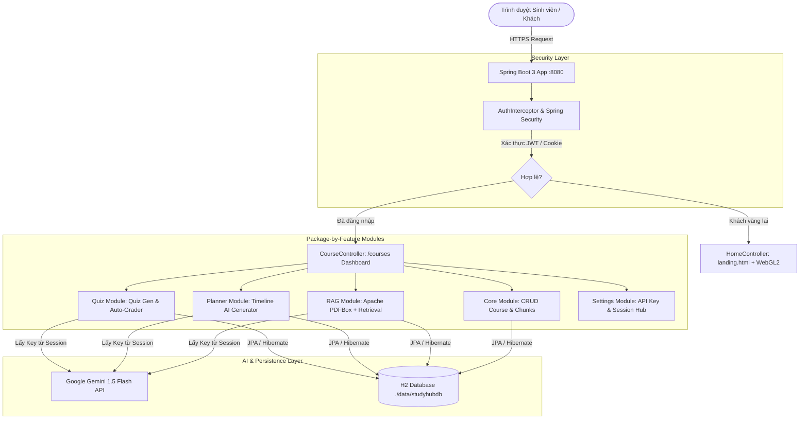
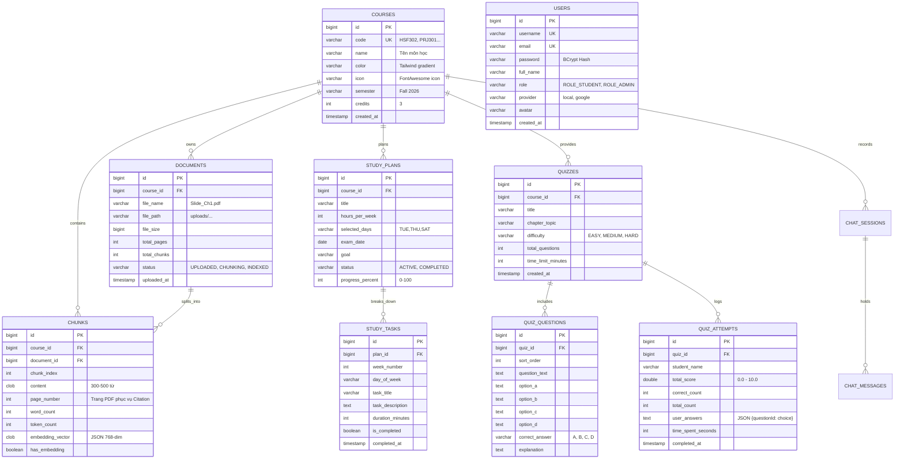

# 01. ĐẶC TẢ YÊU CẦU HỆ THỐNG (SYSTEM SPECIFICATION - SRS)
**Dự án**: **Smart Multi-Course Study Hub & RAG AI Platform**  
**Môn học**: **HSF302 - JPA and Spring Framework** | **Đại học FPT (Fall 2026)**  
**Nhóm thực hiện**: Nhóm 2 (Tùng - Lead, Bình, Ân, Thắng, Nhật, Trường)  
**Phiên bản tài liệu**: 2.0 (Cập nhật kiến trúc Landing Page WebGL2, RAG Vector, AI Planner, Quiz & JWT)

---

## 📑 MỤC LỤC
1. [TỔNG QUAN DỰ ÁN & MỤC TIÊU](#-1-tổng-quan-dự-án--mục-tiêu)
2. [KIẾN TRÚC HỆ THỐNG TỔNG THỂ (SYSTEM ARCHITECTURE)](#-2-kiến-trúc-hệ-thống-tổng-thể-system-architecture)
3. [ĐẶC TẢ YÊU CẦU CHỨC NĂNG TỪNG MODULE (FUNCTIONAL SPECIFICATIONS)](#-3-đặc-tả-yêu-cầu-chức-năng-từng-module-functional-specifications)
   - [3.1. Module Core & Quản lý Khóa học (Tùng)](#31-module-core--quản-lý-khóa-học-tùng)
   - [3.2. Module Xác thực, Phân quyền & JWT (Trường)](#32-module-xác-thực-phân-quyền--jwt-trường)
   - [3.3. Module RAG Knowledge Engine & Chatbot Giáo trình (Bình)](#33-module-rag-knowledge-engine--chatbot-giáo-trình-bình)
   - [3.4. Module AI Study Planner (Thắng)](#34-module-ai-study-planner-thắng)
   - [3.5. Module AI Quiz Generator & Chấm điểm (Nhật)](#35-module-ai-quiz-generator--chấm-điểm-nhật)
   - [3.6. Module Cài đặt & Quản lý API Key (Ân)](#36-module-cài-đặt--quản-lý-api-key-ân)
   - [3.7. Module Marketing Landing Page & WebGL2 (Nhật & Team)](#37-module-marketing-landing-page--webgl2-nhật--team)
4. [ĐẶC TẢ CƠ SỞ DỮ LIỆU & ENTITY (DATABASE SPECIFICATION)](#-4-đặc-tả-cơ-sở-dữ-liệu--entity-database-specification)
5. [ĐẶC TẢ MA TRẬN API & WEB MVC ROUTES](#-5-đặc-tả-ma-trận-api--web-mvc-routes)
6. [ĐẶC TẢ YÊU CẦU PHI CHỨC NĂNG (NON-FUNCTIONAL SPECIFICATIONS)](#-6-đặc-tả-yêu-cầu-phi-chức-năng-non-functional-specifications)
7. [TÍCH HỢP BÊN NGOÀI (EXTERNAL INTEGRATIONS)](#-7-tích-hợp-bên-ngoài-external-integrations)

---

## 🎯 1. TỔNG QUAN DỰ ÁN & MỤC TIÊU

### 1.1. Bối cảnh bài toán
Trong môi trường đào tạo đại học tín chỉ (đặc biệt các môn chuyên ngành Công nghệ thông tin như HSF302, PRJ301, MAS291), sinh viên thường đối mặt với các khó khăn:
- **Tài liệu phân mảnh**: Slide bài giảng, giáo trình PDF hàng trăm trang nằm rải rác, khó tra cứu nhanh trọng tâm kiến thức.
- **Hiện tượng "Ảo giác AI" (Hallucination)**: Khi hỏi các AI thông thường (ChatGPT/Gemini miễn phí không kèm tài liệu), AI thường tự suy đoán hoặc trả lời kiến thức ngoài chương trình đào tạo của trường.
- **Thiếu kế hoạch học tập cá nhân hóa**: Sinh viên không biết phân bổ thời gian ôn tập hợp lý theo lịch rảnh và ngày thi thực tế.
- **Đề thi thử hạn chế**: Sinh viên thiếu nguồn trắc nghiệm sát với giáo trình từng chương để tự kiểm tra năng lực.

### 1.2. Mục tiêu hệ thống
**Smart Multi-Course Study Hub & RAG AI** là nền tảng quản lý học tập thông minh đa môn học tích hợp công nghệ AI tiên tiến:
1. Cung cấp không gian học tập tập trung cho từng môn học (Multi-Course Isolation).
2. Xây dựng bộ máy **RAG (Retrieval-Augmented Generation)** trích xuất PDFBox và truy vấn thông minh, đảm bảo câu trả lời bám sát 100% nội dung giáo trình kèm **Trích dẫn số trang (Page Citations)**.
3. Tự động hóa việc lập kế hoạch ôn thi cá nhân hóa (AI Study Planner).
4. Tự động sinh đề trắc nghiệm chuẩn 4 đáp án theo độ khó và chấm điểm tức thì (AI Quiz Generator).
5. Tối ưu chi phí hạ tầng với mục tiêu **Chi phí vận hành $0 (Zero Server Cost)** nhờ CSDL nhúng H2 File-based và API AI dùng chung hoặc khóa cá nhân lưu trên phiên (Session).

---

## 🏛️ 2. KIẾN TRÚC HỆ THỐNG TỔNG THỂ (SYSTEM ARCHITECTURE)

Hệ thống áp dụng mô hình kiến trúc **Package-by-Feature (Vertical Slice Architecture)** kết hợp với mô hình chuẩn nhiều lớp (**Layered Architecture**) của Spring Boot 3.3.4:

```
src/main/java/com/group2/assignment/
├── core/         --> Module nền tảng: Quản lý khóa học, Chunks chung, Routing trung tâm
├── auth/         --> Module xác thực: User, JWT Service, Cookie, Interceptor, OAuth2
├── rag/          --> Module RAG Engine: Upload PDF, PDFBox Chunking, Chatbot & Citations
├── planner/      --> Module lập kế hoạch: StudyPlan, StudyTask, Timeline Generator
├── quiz/         --> Module trắc nghiệm: Quiz, QuizQuestion, Attempt, Auto-Grading
└── settings/     --> Module cài đặt: Quản lý API Key trên Session, Ping Latency Test
```

### Sơ đồ Luồng Hoạt động (Data & Control Flow):


---

## ⚙️ 3. ĐẶC TẢ YÊU CẦU CHỨC NĂNG TỪNG MODULE (FUNCTIONAL SPECIFICATIONS)

### 3.1. Module Core & Quản lý Khóa học (Tùng - Lead)
* **CRUD Khóa học**:
  - Tạo mới môn học: Nhập mã môn (VD: `HSF302`, `PRJ301`), tên môn, số tín chỉ, học kỳ, mô tả, chọn màu gradient Tailwind và FontAwesome icon.
  - Xem danh sách môn học: Hiển thị dạng lưới (Card Grid) kèm tiến độ, số lượng tài liệu đã tải lên, số câu trắc nghiệm hiện có.
  - Chỉnh sửa thông tin môn học và xóa môn học (Cơ chế Cascade tự động dọn dẹp Document, Chunks, Quizzes và Study Plans tương ứng).
* **Quản trị phân vùng dữ liệu (Course Isolation)**:
  - Mọi tài nguyên học tập (Tài liệu PDF, Chunks, Phiên Chat, Kế hoạch ôn tập, Đề thi) bắt buộc gắn liền với một `course_id` cụ thể, không bị trộn lẫn dữ liệu giữa các môn.
* **Điều hướng tập trung**:
  - Cung cấp Gateway điều hướng thông minh tại `GET /` và `GET /courses`.

### 3.2. Module Xác thực, Phân quyền & JWT (Trường)
* **Đăng ký tài khoản (Local Registration)**:
  - Sinh viên nhập họ tên, username, email, mật khẩu và xác nhận mật khẩu.
  - Mã hóa mật khẩu một chiều bằng thuật toán `BCryptPasswordEncoder` an toàn.
  - Gán quyền mặc định `ROLE_STUDENT`.
* **Đăng nhập & Quản lý Phiên (Authentication & Token)**:
  - Xác thực thông tin đăng nhập theo Username hoặc Email.
  - Sinh chuỗi JSON Web Token (JJWT 0.12.x) mã hóa HS256 với thời hạn sống 24 giờ.
  - Lưu JWT đồng thời vào HttpOnly Cookie `STUDYHUB_JWT` (bảo vệ chống tấn công XSS) và `HttpSession`.
* **Đăng nhập Google OAuth2**:
  - Hỗ trợ đăng nhập 1-click qua tài khoản Google `@fpt.edu.vn` hoặc `@gmail.com`.
  - Tự động đồng bộ / tạo tài khoản mới nếu lần đầu đăng nhập bằng Google.
* **Phân định Khách vãng lai (Guest) vs Khách đăng nhập (Authenticated Student)**:
  - **Khách vãng lai**: Được xem Landing Page (`/`), duyệt môn học chung (`/courses`), xem chi tiết môn học (`/courses/{id}`). Bị chặn hoàn toàn các hành vi ghi dữ liệu (Upload PDF, Chat RAG, Sinh Planner, Làm Quiz, Lưu API Key).
  - **Khách đăng nhập**: Toàn quyền sử dụng các tính năng học tập AI, upload tài liệu, làm bài thi và lưu lịch sử học tập.
  - **Cơ chế Interceptor & Callback**: `JwtAuthInterceptor` tự động chặn khách vãng lai truy cập tính năng riêng tư, lưu `authRedirectUrl` vào Session và chuyển hướng về `/login?error=unauthorized`. Sau khi đăng nhập thành công, tự động đưa người dùng quay lại đúng URL đang dở dang.
  - **Khôi phục phiên tự động**: Khi mở lại trình duyệt bị mất session, hệ thống tự động bóc tách Cookie JWT để phục hồi phiên đăng nhập mà không bắt nhập lại mật khẩu.
* **Hồ sơ cá nhân & Đăng xuất**:
  - `GET /profile`: Xem chi tiết thông tin sinh viên, ảnh avatar, ngày tham gia và trạng thái token.
  - `GET /logout`: Hủy Cookie, vô hiệu hóa Session và điều hướng an toàn về trang đăng nhập.

### 3.3. Module RAG Knowledge Engine & Chatbot Giáo trình (Bình)
* **Tải lên & Trích xuất Giáo trình (PDF Ingestion)**:
  - Cho phép tải lên file giáo trình PDF (dung lượng tối đa 25MB).
  - Tự động lưu file vào thư mục vật lý `./uploads/courses/{courseId}/`.
  - Sử dụng **Apache PDFBox 3.0.3** trích xuất nguyên vẹn văn bản theo từng trang.
* **Bộ máy Chia đoạn thông minh (Smart Chunking)**:
  - Thuật toán cắt nhỏ văn bản từ 300 - 500 từ mỗi Chunk, bảo lưu số trang (`pageNumber`) phục vụ việc trích dẫn.
  - Lưu trữ các Chunk vào bảng CSDL `chunks` có lập chỉ mục tìm kiếm.
* **Truy vấn & Trợ lý Hỏi đáp (RAG Chatbot)**:
  - Thuật toán kết hợp Keyword Match & Term Frequency (TF-IDF) tìm ra Top-K Chunk sát nhất với câu hỏi.
  - Đóng gói System Prompt nghiêm ngặt (Grounded Generation) gửi đến Google Gemini 1.5 Flash.
  - Trả về câu trả lời định dạng Markdown kèm **Thẻ trích dẫn (Citation Badges)** ghi rõ số trang và đoạn tài liệu gốc.
  - Lưu trữ lịch sử hỏi đáp (`ChatSession`, `ChatMessage`) cho từng môn học.

### 3.4. Module AI Study Planner (Thắng)
* **Thu thập dữ liệu kế hoạch cá nhân**:
  - Form tiếp nhận: Môn học cần ôn, số giờ rảnh mỗi tuần (1 - 40h), các ngày rảnh trong tuần (`selectedDays`: TUE, THU, SAT...), ngày thi cuối kỳ (`examDate`), mục tiêu điểm số.
* **Sinh Lộ trình Ôn thi thông minh (AI Timeline Generation)**:
  - Đọc toàn bộ Chunks kiến thức của môn học, gửi System Prompt sang Gemini yêu cầu phân bổ khối lượng bài học vừa sức chia đều theo từng tuần.
  - Hỗ trợ Fallback sinh Mock Timeline nếu người dùng chưa nhập API Key cá nhân.
  - Lưu trữ kế hoạch (`StudyPlan`) và danh sách các nhiệm vụ cụ thể (`StudyTask`).
* **Theo dõi tiến độ học tập (Progress Tracking)**:
  - Giao diện Timeline trực quan bằng DaisyUI Steps / Timeline Component.
  - Cho phép sinh viên tick chọn hoàn thành từng nhiệm vụ (Task Checkmark), tự động tính toán lại tỷ lệ `%` hoàn thành của môn học.

### 3.5. Module AI Quiz Generator & Chấm điểm (Nhật)
* **Cấu hình sinh đề trắc nghiệm**:
  - Lựa chọn nguồn tài liệu: Từ file PDF mới tải lên hoặc từ tài liệu đã có trong môn học.
  - Tùy chọn phạm vi trang (Từ trang - Đến trang), chủ đề chương học, số lượng câu hỏi (5 hoặc 10 câu), độ khó (`EASY`, `MEDIUM`, `HARD`), thời gian làm bài (phút).
* **Động cơ Sinh câu hỏi bằng AI**:
  - Prompt ép Gemini trả về chuỗi JSON thuần túy (loại bỏ markdown format) gồm 4 lựa chọn khách quan A, B, C, D, đáp án đúng và lời giải thích có dẫn chứng.
  - Tự động parse và lưu vào bảng `quizzes` và `quiz_questions`.
* **Giao diện Thi thử & Chấm điểm tức thì (Instant Auto-Grading)**:
  - Màn hình làm bài thi có đồng hồ đếm ngược thời gian thực.
  - Nhận bài làm của sinh viên qua HTTP POST, tự động chấm điểm theo thang điểm 10.
  - Lưu lại lần thi (`QuizAttempt`) kèm chi tiết từng đáp án đã chọn.
  - Trang kết quả (`/quiz/attempts/{id}`): Đổi màu trực quan (Xanh = Đúng, Đỏ = Sai) và mở hộp Accordion giải thích lý do vì sao đáp án đúng dựa trên giáo trình.

### 3.6. Module Admin Dashboard, System Analytics & Quản trị Gói cước (Ân)
* **Bảng điều khiển Thống kê KPI Thời gian thực (Real-time Analytics Dashboard)**:
  - Giao diện `/admin/dashboard` hiển thị các chỉ số vận hành hệ thống: Tổng số người dùng (phân chia theo gói Free/Pro), tỷ lệ chuyển đổi Pro, tổng số môn học, tổng số đoạn Chunks và tổng số lượt truy vấn RAG trong ngày.
  - Biểu đồ tiến trình Radial Progress thể hiện tỷ lệ % người dùng Pro.
* **Quản trị Sinh viên & Can thiệp Gói cước 1-Click (User & Tier Management)**:
  - Bảng danh sách toàn bộ sinh viên, hiển thị chi tiết số câu hỏi đã dùng hôm nay và gói cước hiện tại.
  - Cung cấp nút 1-Click chuyển đổi gói cước: Nâng cấp `PRO` hoặc Hạ cấp `FREE` ngay tức thì phục vụ demo và vận hành.
* **Cung cấp Centralized System API Key & Kiểm tra Kết nối AI**:
  - Hệ thống cung cấp sẵn 1 System API Key duy nhất, sinh viên không cần tự dán key cá nhân.
  - Quản trị viên có thể cập nhật key hệ thống và thực hiện Ping Test đo độ trễ mạng mili-giây (ms) tới Google Gemini API.
* **Động cơ Kiểm soát Hạn ngạch (Quota Engine)**:
  - Kiểm soát giới hạn: Gói Free tối đa 3 môn học, 50 câu hỏi RAG/ngày (tự động reset lúc 00:00), khóa tính năng AI Study Planner. Gói Pro mở khóa toàn bộ.

### 3.7. Module Marketing Landing Page & WebGL2 (Nhật & Team)
* **Cổng chào tiếp thị hiện đại (Marketing Gateway)**:
  - Phục vụ người dùng vãng lai tại `GET /`, thiết kế giao diện Glassmorphism Dark Mode (`data-theme="dark"`).
* **Đồ họa WebGL2 GPU-Accelerated**:
  - `gradient-ascii.js`: Nền ma trận ký tự ASCII chuyển sắc theo thời gian thực tại Hero Section.
  - `specular-button.js`: Đổ bóng viền sáng gương bám theo con trỏ chuột cho nút CTA.
  - `cursor-grid.js`: Lưới tương tác toàn màn hình phát sóng xung kích (Shockwave pulse) khi di chuột.
* **Trình diễn tính năng thực tế**:
  - Mockup 3D Tilt tương tác theo tọa độ chuột.
  - Split-view 2 cột (Document Viewer + Live RAG Chatbox mô phỏng 3 kịch bản prompt HSF302, PRJ301, MAS291).
  - Vòng lặp công nghệ Infinite Marquee, Bảng giá gói học tập (Pricing toggle tháng/kỳ), Student Testimonials và FAQ.

---

## 🗄️ 4. ĐẶC TẢ CƠ SỞ DỮ LIỆU & ENTITY (DATABASE SPECIFICATION)

Cơ sở dữ liệu sử dụng **H2 Database** lưu bền vững ra file đĩa cục bộ (`./data/studyhubdb.mv.db`), tương thích chuẩn JPA/Hibernate 6.5.



---

## 🌐 5. ĐẶC TẢ MA TRẬN API & WEB MVC ROUTES

| Phương thức | Endpoint URL | Phân quyền | Module phụ trách | Mô tả chức năng |
|:---|:---|:---|:---|:---|
| `GET` | `/` | Public | Core & Landing | Hiển thị Landing Page nếu là khách; Redirect `/courses` nếu đã login |
| `GET` | `/dashboard` | Public | Core | Redirect về `/courses` để tương thích ngược |
| `GET` | `/courses` | Public | Core (Tùng) | Trang Dashboard hiển thị danh sách các môn học |
| `GET` | `/courses/new` | User | Core (Tùng) | Modal / Giao diện tạo môn học mới |
| `POST` | `/courses` | User | Core (Tùng) | Tiếp nhận submit tạo môn học mới và lưu CSDL |
| `GET` | `/courses/{id}/edit`| User | Core (Tùng) | Form chỉnh sửa môn học |
| `POST` | `/courses/{id}/delete`| User | Core (Tùng) | Xóa môn học (Cascade delete toàn bộ tài liệu & đề thi) |
| `GET` | `/login` | Public | Auth (Trường) | Giao diện đăng nhập sinh viên |
| `POST` | `/login` | Public | Auth (Trường) | Xác thực tài khoản, cấp phát Cookie JWT và tạo phiên |
| `GET` | `/register` | Public | Auth (Trường) | Giao diện đăng ký tài khoản sinh viên |
| `POST` | `/register` | Public | Auth (Trường) | Tạo tài khoản mới, mã hóa BCrypt mật khẩu |
| `GET` | `/profile` | User | Auth (Trường) | Xem thông tin hồ sơ cá nhân và trạng thái token |
| `GET` | `/logout` | User | Auth (Trường) | Đăng xuất, xóa Cookie JWT và hủy Session |
| `GET` | `/courses/{id}/documents` | User | RAG (Bình) | Xem danh sách file PDF giáo trình và các đoạn Chunks |
| `POST` | `/courses/{id}/documents/upload` | User | RAG (Bình) | Upload file PDF giáo trình, trích xuất text & cắt chunk |
| `GET` | `/courses/{id}/chat` | User | RAG (Bình) | Màn hình chat trực quan với AI trợ lý giáo trình |
| `POST` | `/courses/{id}/chat/send` | User | RAG (Bình) | Gửi câu hỏi, tìm kiếm Top-K Chunks và sinh câu trả lời RAG |
| `GET` | `/planner` | User | Planner (Thắng) | Giao diện form lập kế hoạch và lịch sử lộ trình |
| `POST` | `/planner/generate` | User | Planner (Thắng) | Gọi AI sinh Timeline kế hoạch ôn tập theo Chunks |
| `GET` | `/planner/{planId}` | User | Planner (Thắng) | Xem chi tiết Timeline lộ trình ôn tập tuần/ngày |
| `POST` | `/planner/tasks/{taskId}/toggle` | User | Planner (Thắng) | Đánh dấu hoàn thành / chưa hoàn thành nhiệm vụ |
| `GET` | `/quiz` | User | Quiz (Nhật) | Danh sách đề thi trắc nghiệm theo môn và form sinh đề |
| `POST` | `/quiz/generate` | User | Quiz (Nhật) | Tiếp nhận cấu hình và gọi AI sinh bộ câu hỏi trắc nghiệm |
| `GET` | `/quiz/{quizId}/take` | User | Quiz (Nhật) | Màn hình làm bài thi trắc nghiệm trực quan (có đồng hồ đếm ngược) |
| `POST` | `/quiz/{quizId}/submit` | User | Quiz (Nhật) | Nộp bài làm, tự động so khớp đáp án và tính điểm |
| `GET` | `/quiz/attempts/{attemptId}` | User | Quiz (Nhật) | Màn hình xem lại kết quả chi tiết, điểm số và giải thích |
| `GET` | `/admin/dashboard` | Admin | Admin Hub (Ân) | Bảng điều khiển KPI thống kê thời gian thực (Users, Courses, RAG Queries) |
| `GET` | `/admin/users` | Admin | Admin Hub (Ân) | Bảng danh sách sinh viên & theo dõi số câu hỏi RAG đã dùng hôm nay |
| `POST` | `/admin/users/{id}/upgrade-pro` | Admin | Admin Hub (Ân) | Nút 1-Click nâng cấp tài khoản sinh viên lên Gói Pro |
| `POST` | `/admin/users/{id}/downgrade-free` | Admin | Admin Hub (Ân) | Nút 1-Click hạ tài khoản sinh viên về Gói Free |
| `GET` | `/admin/settings` | Admin | Admin Hub (Ân) | Màn hình cấu hình System API Key tập trung |
| `POST` | `/admin/settings/test-ping` | Admin | Admin Hub (Ân) | Kiểm tra Ping kết nối Gemini API và đo độ trễ ms |

---

## ⚡ 6. ĐẶC TẢ YÊU CẦU PHI CHỨC NĂNG (NON-FUNCTIONAL SPECIFICATIONS)

1. **Hiệu năng & Tốc độ phản hồi (Performance & Latency)**:
   - Các trang Web MVC thông thường tải trong vòng $\le 500\text{ms}$.
   - Truy vấn tìm kiếm Chunks trong CSDL H2 nội bộ đạt tốc độ $\le 400\text{ms}$.
   - Đồ họa WebGL2 trên trang Landing Page duy trì khung hình mượt mà $60\text{fps}$ trên các thiết bị hỗ trợ card đồ họa rời hoặc GPU tích hợp.
2. **Chi phí Vận hành Hạ tầng ($0 Operational Cost)**:
   - Cơ sở dữ liệu H2 lưu trữ File nhúng ngay trong dự án, không đòi hỏi chi phí thuê máy chủ CSDL riêng biệt (như AWS RDS hay Azure SQL).
   - Gemini 1.5 Flash API có hạn ngạch miễn phí dồi dào, cho phép hệ thống vận hành $0 phát sinh.
3. **Tính Toàn vẹn & Bảo mật (Security & Integrity)**:
   - Mật khẩu người dùng được băm bằng chuẩn `BCrypt` với độ phức tạp cao, chống tấn công dò mật khẩu Rainbow Table.
   - Token JWT được bảo vệ qua Cookie `HttpOnly; SameSite=Lax`, ngăn chặn hoàn toàn việc đánh cắp token bằng script độc hại (Cross-Site Scripting - XSS).
   - API Key của AI tuyệt đối không bị lưu cứng vào mã nguồn, Database hay commit lên GitHub; chỉ lưu tạm thời trên `HttpSession`.
4. **Khả năng tương thích & Responsive (Compatibility)**:
   - Giao diện tối ưu chuẩn trên cả màn hình Desktop (Full HD 1920x1080, Laptop 1366x768) và thiết bị di động (Mobile Responsive).
   - Tương thích tốt trên các trình duyệt hiện đại: Chrome, Edge, Firefox, Safari.

---

## 🔌 7. TÍCH HỢP BÊN NGOÀI (EXTERNAL INTEGRATIONS)

1. **Google Gemini API (`gemini-1.5-flash` & `gemini-2.5-flash`)**:
   - Sử dụng để sinh câu trả lời RAG, sinh lộ trình học tập Timeline JSON và sinh đề thi trắc nghiệm.
   - Giao thức: HTTPS REST API qua `RestClient` hoặc Java `HttpClient`.
2. **Apache PDFBox 3.0.3**:
   - Thư viện mã nguồn mở phân tích cấu trúc tài liệu PDF, bóc tách chuỗi ký tự theo tọa độ vị trí thực tế (`PDFTextStripper.setSortByPosition(true)`).
3. **Google Identity Services (OAuth 2.0 Client)**:
   - Tích hợp chuẩn OpenID Connect / OAuth2 xác thực tài khoản Google của sinh viên.
4. **Tailwind CSS & DaisyUI v4 (CDN Engine)**:
   - Hệ thống Design System giao diện Glassmorphism với bộ màu thương hiệu chuyên biệt và bộ icon FontAwesome 6.

