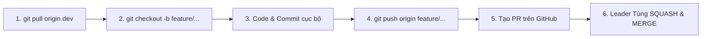

# 02. QUY CHUẨN LÀM VIỆC GIT & BUSINESS RULES CHO NHÓM (GIT WORKFLOW SPECIFICATION)
**Dự án**: **Smart Multi-Course Study Hub & RAG AI**  
**Repository**: [https://github.com/Tung-pro123/Smart-StudyHub-RAG](https://github.com/Tung-pro123/Smart-StudyHub-RAG)  
**Tác giả**: Leader Tùng (Project Manager & Tech Lead)

Tài liệu này thiết lập các **Business Rules (Quy tắc bắt buộc)** và quy trình làm việc trên Git/GitHub dành cho toàn bộ 6 thành viên trong nhóm, nhằm đảm bảo **lịch sử commit sạch đẹp 100%, không commit rác và loại trừ hoàn toàn xung đột mã nguồn (Merge Conflict)**.

---

## 🛑 1. BA QUY TẮC BẤT DI BẤT DỊCH (CORE BUSINESS RULES)

### 📌 QUY TẮC 1: CẤM TUYỆT ĐỐI PUSH TRỰC TIẾP VÀO `main` VÀ `dev`
* **Mọi thành viên (kể cả Leader)** đều **KHÔNG ĐƯỢC PHÉP** chạy lệnh:
  ```bash
  git push origin dev    # ❌ BỊ CẤM HOÀN TOÀN
  git push origin main   # ❌ BỊ CẤM HOÀN TOÀN
  ```
* Bất kỳ dòng code nào muốn đưa vào dự án đều **bắt buộc phải đi qua 1 Pull Request (PR)** từ nhánh tính năng (`feature/`) vào nhánh `dev`.

---

### 📌 QUY TẮC 2: BẮT BUỘC DÙNG "SQUASH AND MERGE" KHI DUYỆT PR
* **Tại sao phải dùng Squash and Merge?**
  * Trong quá trình dev một tính năng, các bạn thường tạo ra nhiều commit vụn vặt: *"fix typo"*, *"test thử api"*, *"sửa lại css"*, *"commit test"*...
  * Nếu dùng Merge thông thường (Merge Commit), toàn bộ các commit rác đó sẽ tràn vào nhánh `dev` và `main`, làm cây lịch sử Git bị rối rắm, giảng viên kiểm tra Git log sẽ trừ điểm chuyên nghiệp.
  * Khi chọn **Squash and Merge**, GitHub sẽ **tự động nén toàn bộ 5 - 20 commit lặt vặt của nhánh feature thành đúng 1 commit duy nhất**, sạch sẽ và đại diện trọn vẹn cho tính năng đó trên nhánh `dev`!
* **Quy định**: Chỉ có **Leader Tùng** (hoặc Master QA Trường được ủy quyền) mới có quyền bấm nút **Squash and Merge** sau khi đã kiểm tra code chạy ổn định.

---

### 📌 QUY TẮC 3: ĐỒNG NHẤT 100% TIẾNG VIỆT CHO TIÊU ĐỀ (PR TITLE) VÀ MÔ TẢ (PR DESCRIPTION)
* **Quy tắc ngôn ngữ**: Toàn bộ **Tiêu đề PR (Title)** và **Nội dung mô tả (Description)** **BẮT BUỘC ĐỒNG NHẤT 100% BẰNG TIẾNG VIỆT** (có dấu, rõ nghĩa, không nửa nạc nửa mỡ Anh - Việt).
* **Định dạng Title PR**: Viết theo chuẩn **Conventional Commits**:
  ```text
  <loại>(<phạm-vi>): <mô tả ngắn gọn tính năng bằng tiếng Việt có dấu>
  ```
  *Ví dụ chuẩn*: `feat(quiz): hoàn thiện bộ sinh trắc nghiệm và chấm điểm tự động`
* **Nội dung Description**: Phải điền đầy đủ theo mẫu chuẩn Tiếng Việt (GitHub đã tự động điền sẵn mẫu trong `.github/pull_request_template.md`).

---

## 🌳 2. QUY ĐỊNH TÊN NHÁNH CỤ THỂ CHO TỪNG THÀNH VIÊN

Tất cả các nhánh tính năng đều phải được rẽ nhánh (checkout) từ nhánh `dev`:

| Thành viên | Tên nhánh BẮT BUỘC | Phạm vi Module phụ trách |
|:---|:---|:---|
| **BÌNH** 🌟 | `feature/rag-engine` | Upload PDF, Apache PDFBox Chunking, Chatbot RAG, Lịch sử chat |
| **ÂN** | `feature/settings-security` | Giao diện cài đặt API Key, Test Ping kết nối, Lưu `HttpSession` |
| **THẮNG** | `feature/study-planner` | Form nhập lịch rảnh & ngày thi, AI Study Planner Timeline |
| **NHẬT** 🚀 | `feature/quiz-generator` | Bộ lọc chọn chương & độ khó, AI Multiple Choice, Chấm điểm |
| **TRƯỜNG** | `docs/user-guide-and-slides` | Biên soạn User Guide Word/PDF, Thiết kế Slide PowerPoint |
| **Khi sửa Bug** | `fix/<tên-lỗi-ngắn-gọn>` | Ví dụ: `fix/api-key-null-pointer`, `fix/css-card-overflow` |

---

## 📝 3. TIÊU CHUẨN ĐẶT TIÊU ĐỀ PULL REQUEST (PR TITLE)

Khi mở Pull Request trên GitHub, tiêu đề PR **bắt buộc** phải tuân theo cú pháp sau để sau khi **Squash and Merge**, lịch sử Git của nhóm đẹp như dự án quốc tế:

### Các tiền tố hợp lệ:
* `feat(rag): ...` $\rightarrow$ Tính năng thuộc Module RAG của Bình.
  * *Ví dụ*: `feat(rag): tích hợp Apache PDFBox chunking và khung chat giáo trình`
* `feat(settings): ...` $\rightarrow$ Tính năng thuộc Module Settings của Ân.
  * *Ví dụ*: `feat(settings): tạo form cấu hình API Key và ping test kết nối Gemini`
* `feat(planner): ...` $\rightarrow$ Tính năng thuộc Module Study Planner của Thắng.
  * *Ví dụ*: `feat(planner): form chọn ngày rảnh và timeline kế hoạch ôn thi DaisyUI`
* `feat(quiz): ...` $\rightarrow$ Tính năng thuộc Module Quiz Generator của Nhật.
  * *Ví dụ*: `feat(quiz): bộ sinh đề trắc nghiệm 4 đáp án theo chương và chấm điểm tức thì`
* `docs(guide): ...` $\rightarrow$ Tài liệu và Slide của Trường.
  * *Ví dụ*: `docs(guide): bổ sung tài liệu User Guide Word và Slide PowerPoint 15 trang`
* `fix(<module>): ...` $\rightarrow$ Sửa lỗi phát sinh.
  * *Ví dụ*: `fix(core): sửa lỗi validate trùng mã môn học khi tạo mới`

### 📋 Mẫu nội dung mô tả PR (PR Description Template) - 100% Tiếng Việt
*(Mỗi khi mở PR trên GitHub, hệ thống sẽ tự động chèn sẵn mẫu này, thành viên chỉ cần tick chọn và điền thông tin)*:
```markdown
## 📌 Mô tả công việc
- [Mô tả chi tiết những gì bạn đã làm trong nhánh này]

## 🎯 Module phụ trách
- [ ] `rag`: Trích xuất PDF, RAG Engine và Chatbot hỏi đáp (Bình)
- [ ] `settings`: Giao diện cấu hình API Key và kiểm tra kết nối AI (Ân)
- [ ] `planner`: Lên kế hoạch ôn tập thông minh Study Planner (Thắng)
- [ ] `quiz`: Bộ sinh trắc nghiệm tự động và chấm điểm tức thì (Nhật)
- [ ] `docs`: Tài liệu hướng dẫn User Guide và Slide thuyết trình (Trường)

## 📋 Checklist kiểm tra trước khi tạo PR
- [x] Tiêu đề PR tuân thủ đúng chuẩn Conventional Commits bằng **100% Tiếng Việt**
- [x] Tên nhánh đúng chuẩn: feature/<tên-chức-năng> hoặc fix/<tên-lỗi>
- [x] Đã chạy mvn clean test ở máy local và BUILD SUCCESS
- [x] Không sửa đổi các file ngoài phạm vi module được phân công
```

---

## 🔄 4. QUY TRÌNH 5 BƯỚC LÀM VIỆC TỪ A - Z CHO MỖI THÀNH VIÊN



### Bước 1: Luôn cập nhật code mới nhất từ `dev`
Trước khi bắt đầu code ca làm việc mới, luôn kéo code mới nhất về:
```bash
git checkout dev
git pull origin dev
```

### Bước 2: Tạo nhánh tính năng đúng tên quy định
Ví dụ bạn Nhật bắt đầu làm phần trắc nghiệm:
```bash
git checkout -b feature/quiz-generator
```

### Bước 3: Code và Commit thoải mái trên máy cá nhân
Trong nhánh của mình, bạn có thể commit nhiều lần để lưu tiến độ công việc:
```bash
git add .
git commit -m "feat(quiz): dựng giao diện trắc nghiệm với radio buttons"
```

### Bước 4: Đẩy nhánh cá nhân lên GitHub
```bash
git push -u origin feature/quiz-generator
```

### Bước 5: Mở Pull Request (PR) trên GitHub
1. Vào GitHub repo: [https://github.com/Tung-pro123/Smart-StudyHub-RAG](https://github.com/Tung-pro123/Smart-StudyHub-RAG)
2. Bấm nút màu xanh **Compare & pull request**.
3. **CỰC KỲ QUAN TRỌNG**: 
   * **Base branch**: chọn `dev` (KHÔNG ĐƯỢC CHỌN `main`).
   * **Compare branch**: chọn nhánh của bạn (ví dụ: `feature/quiz-generator`).
4. Điền Title PR theo chuẩn: `feat(quiz): hoàn thiện bộ sinh trắc nghiệm và chấm điểm tự động`.
5. Báo lên nhóm Zalo: *"Leader ơi, mình vừa tạo PR module Quiz, nhờ Tùng review nhé!"*

---

## 🛡️ 5. HƯỚNG DẪN CẤU HÌNH "CHỐNG COMMIT RÁC" TRÊN GITHUB (DÀNH CHO LEADER TÙNG)

Để hệ thống tự động cưỡng chế 100% các Business Rules trên mà không sợ thành viên làm sai sót, Tùng hãy vào cài đặt Repo như sau:

### ⚙️ Thiết lập 1: Bắt buộc chế độ "Squash and Merge"
1. Mở GitHub repo: `https://github.com/Tung-pro123/Smart-StudyHub-RAG` $\rightarrow$ Bấm tab **Settings**.
2. Cuộn xuống mục **Pull Requests**:
   * 🔲 **BỎ TÍCH**: *Allow merge commits* (ngăn việc merge tạo commit rác).
   * 🔲 **BỎ TÍCH**: *Allow rebase merging*.
   * ✅ **TÍCH CHỌN DUY NHẤT**: **Allow squash merging**.
   * ✅ **TÍCH CHỌN**: **Automatically delete head branches** (để khi merge xong, GitHub tự động xóa nhánh feature cũ, giữ repo luôn gọn gàng).

### ⚙️ Thiết lập 2: Khóa nhánh `main` và `dev` (Branch Protection Rules)
1. Trong **Settings** $\rightarrow$ bấm mục **Branches** (cột trái) $\rightarrow$ bấm **Add branch protection rule**.
2. **Branch name pattern**: nhập `main` (làm tiếp tương tự cho `dev`).
3. Tích chọn:
   * ✅ **Require a pull request before merging** (Bắt buộc phải qua PR, không ai được push thẳng).
   * ✅ **Require approvals**: chọn 1 (Bắt buộc có review).
4. Bấm **Create** để lưu.

---

## ⚡ 6. XỬ LÝ CONFLICT (NẾU CÓ)
Nhờ kiến trúc **Package-by-Feature**, mỗi bạn làm trong 1 thư mục riêng biệt (`rag`, `planner`, `quiz`, `settings`) nên khả năng conflict là **gần như 0%**.  
Tuy nhiên nếu có ai vô tình sửa chung file cấu hình, chỉ cần thực hiện:
```bash
git checkout feature/ten-nhanh-cua-ban
git fetch origin
git merge origin/dev
# Mở IntelliJ giải quyết conflict (Accept Incoming / Current)
git add .
git commit -m "fix: resolve merge conflicts with dev"
git push origin feature/ten-nhanh-cua-ban
```
