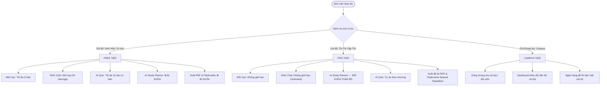
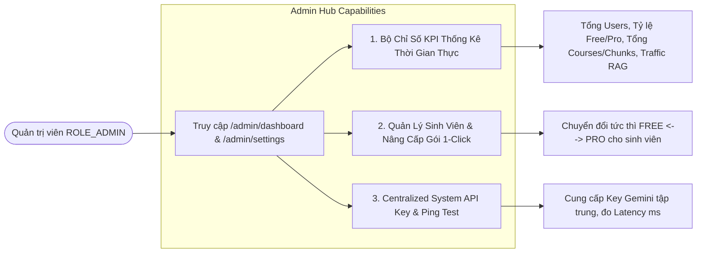

# 03. TÀI LIỆU QUY TẮC NGHIỆP VỤ HỆ THỐNG (BUSINESS RULES SPECIFICATION - BRD)
**Dự án**: **Smart Multi-Course Study Hub & RAG AI Platform**  
**Môn học**: **HSF302 - JPA and Spring Framework** | **Đại học FPT (Fall 2026)**  
**Nhóm thực hiện**: Nhóm 2 (Tùng - Lead, Bình, Ân, Thắng, Nhật, Trường)  
**Phiên bản tài liệu**: 3.0 (Tích hợp chuẩn Hạng gói cước SaaS, Centralized System Key & Admin Analytics Hub)

---

## 📑 MỤC LỤC
1. [GIỚI THIỆU & NGUYÊN TẮC QUẢN LÝ QUY TẮC](#-1-giới-thiệu--nguyên-tắc-quản-lý-quy-tắc)
2. [HỆ THỐNG MÃ HÓA QUY TẮC (RULE CODING CONVENTION)](#-2-hệ-thống-mã-hóa-quy-tắc-rule-coding-convention)
3. [QUY TẮC PHÂN HỆ QUẢN LÝ MÔN HỌC (CORE & COURSES)](#-3-quy-tắc-phân-hệ-quản-lý-môn-học-core--courses)
4. [QUY TẮC PHÂN HỆ XÁC THỰC & BẢO MẬT (AUTH & SECURITY)](#-4-quy-tắc-phân-hệ-xác-thực--bảo-mật-auth--security)
5. [QUY TẮC PHÂN ĐỊNH KHÁCH VÃNG LAI VÀ NGƯỜI DÙNG ĐĂNG NHẬP (GUEST VS AUTHENTICATED USERS)](#-5-quy-tắc-phân-định-khách-vãng-lai-và-người-dùng-đăng-nhập-guest-vs-authenticated-users)
6. [QUY TẮC PHÂN HỆ GÓI CƯỚC & HẠN NGẠCH HỌC TẬP (SUBSCRIPTION TIERS & QUOTA ENGINE)](#-6-quy-tắc-phân-hệ-gói-cước--hạn-ngạch-học-tập-subscription-tiers--quota-engine)
7. [QUY TẮC PHÂN HỆ QUẢN TRỊ ADMIN DASHBOARD & THỐNG KÊ (ADMIN HUB & SYSTEM ANALYTICS)](#-7-quy-tắc-phân-hệ-quản-trị-admin-dashboard--thống-kê-admin-hub--system-analytics)
8. [QUY TẮC PHÂN HỆ RAG & XỬ LÝ GIÁO TRÌNH (RAG & PDF PROCESSING)](#-8-quy-tắc-phân-hệ-rag--xử-lý-giáo-trình-rag--pdf-processing)
9. [QUY TẮC PHÂN HỆ LẬP KẾ HOẠCH HỌC TẬP (AI STUDY PLANNER)](#-9-quy-tắc-phân-hệ-lập-kế-hoạch-học-tập-ai-study-planner)
10. [QUY TẮC PHÂN HỆ SINH ĐỀ & CHẤM ĐIỂM TRẮC NGHIỆM (AI QUIZ GENERATOR)](#-10-quy-tắc-phân-hệ-sinh-đề--chấm-điểm-trắc-nghiệm-ai-quiz-generator)
11. [QUY TẮC ĐIỀU HƯỚNG & XỬ LÝ DỰ PHÒNG HỆ THỐNG (SYSTEM & FALLBACK)](#-11-quy-tắc-điều-hướng--xử-lý-dự-phòng-hệ-thống-system--fallback)

---

## 🎯 1. GIỚI THIỆU & NGUYÊN TẮC QUẢN LÝ QUY TẮC

Tài liệu này xác định các **Quy tắc Nghiệp vụ (Business Rules)** mang tính bắt buộc chi phối hành vi xử lý dữ liệu, kiểm tra tính hợp lệ (Validation), tính toán logic, phân quyền truy cập, kiểm soát hạn ngạch (Quota) và các ràng buộc bảo mật trong hệ thống **Smart Multi-Course Study Hub & RAG AI**.

Mọi lập trình viên khi phát triển Controller, Service, Interceptor, JPA Entity hay giao diện Thymeleaf **bắt buộc phải tuân thủ nghiêm ngặt** các quy tắc được định nghĩa dưới đây nhằm đảm bảo tính toàn vẹn dữ liệu, phân quyền chuẩn mực và trải nghiệm người dùng tối ưu.

---

## 🏷️ 2. HỆ THỐNG MÃ HÓA QUY TẮC (RULE CODING CONVENTION)

Mỗi quy tắc được định danh duy nhất theo cú pháp:
$$\mathbf{BR\text{-}[MODULE]\text{-}[NUMBER]}$$

* **BR-CORE**: Phân hệ Môn học & Quản trị dữ liệu dùng chung (Tùng)
* **BR-AUTH**: Phân hệ Xác thực, Tài khoản, JWT & Google OAuth2 (Trường)
* **BR-ROLE**: Phân định Vai trò, Quyền hạn Khách vãng lai và Khách đăng nhập (Trường & Team)
* **BR-TIER**: Phân hệ Hạng Gói Cước & Động cơ Hạn ngạch Học tập Quota Engine (Ân & Team)
* **BR-ADMIN**: Phân hệ Quản trị Admin Dashboard, Thống kê Hệ thống & System Key (Ân)
* **BR-RAG**: Phân hệ Trích xuất PDF, Cắt Chunk & RAG Grounded Chat (Bình)
* **BR-PLAN**: Phân hệ AI Study Planner & Timeline (Thắng)
* **BR-QUIZ**: Phân hệ Sinh đề thi, Chấm điểm trắc nghiệm (Nhật)
* **BR-SYS**: Phân hệ Điều hướng toàn cục, Phiên làm việc & Graceful Fallback

---

## 📚 3. QUY TẮC PHÂN HỆ QUẢN LÝ MÔN HỌC (CORE & COURSES)

### 📌 BR-CORE-001: Tính duy nhất và Định dạng của Mã Môn học (Course Code)
* **Mức độ**: `CRITICAL`
* **Mô tả**: Mã môn học (`code`) là định danh duy nhất của môn học trong toàn bộ hệ thống (Unique Constraint).
* **Ràng buộc**:
  - Độ dài từ 3 đến 20 ký tự.
  - Chỉ chấp nhận các ký tự chữ hoa không dấu và chữ số, không chứa khoảng trắng hoặc ký tự đặc biệt (Regex: `^[A-Z0-9]{3,20}$`).
  - Hệ thống tự động chuyển thành chữ hoa (`toUpperCase().trim()`) trước khi lưu vào CSDL.
* **Xử lý vi phạm**: Ném `IllegalArgumentException("Mã môn học đã tồn tại hoặc không đúng định dạng!")`, báo lỗi đỏ trên form.

### 📌 BR-CORE-002: Ràng buộc Xóa tầng Dữ liệu (Cascade Deletion Integrity)
* **Mức độ**: `CRITICAL`
* **Mô tả**: Khi người dùng xóa một Khóa học (`Course`), toàn bộ dữ liệu phụ thuộc liên quan đến môn học đó phải được dọn dẹp sạch sẽ để tránh dữ liệu mồ côi (Orphan records) làm phình to CSDL.
* **Hành vi**:
  - Xóa tầng tự động (Database Cascade / JPA Cascade): Toàn bộ `Document`, `Chunk`, `ChatSession`, `ChatMessage`, `StudyPlan`, `StudyTask`, `Quiz`, `QuizQuestion`, `QuizAttempt` có `course_id` tương ứng bị xóa hoàn toàn.
  - Dọn dẹp tệp vật lý: Toàn bộ thư mục tệp upload `./uploads/courses/{courseId}/` được xóa khỏi ổ cứng server.

### 📌 BR-CORE-003: Phân lập Không gian Học tập (Course Data Isolation)
* **Mức độ**: `HIGH`
* **Mô tả**: Dữ liệu của một môn học phải hoàn toàn độc lập với các môn học khác.
* **Hành vi**:
  - Không cho phép gán hoặc tái sử dụng Chunks tài liệu của môn này cho môn khác.
  - Khi sinh viên đang trong ngữ cảnh của môn HSF302, các chức năng RAG Chat, Quiz và Study Planner chỉ được đọc dữ liệu thuộc về `courseId` đó.

---

## 🛡️ 4. QUY TẮC PHÂN HỆ XÁC THỰC & BẢO MẬT (AUTH & SECURITY)

### 📌 BR-AUTH-001: Quy chuẩn Tài khoản & Đăng ký (User Registration Rules)
* **Mức độ**: `CRITICAL`
* **Mô tả**: Kiểm soát tính duy nhất và an toàn khi người dùng tạo tài khoản mới.
* **Ràng buộc**:
  - `username`: Độ dài 4 - 50 ký tự, không phân biệt hoa thường, phải duy nhất trong hệ thống.
  - `email`: Phải tuân theo định dạng email chuẩn RFC 5322, không phân biệt hoa thường, phải duy nhất trong hệ thống.
  - `password`: Tối thiểu 6 ký tự. Khi đăng ký, trường `password` và `confirmPassword` phải trùng khớp 100%.
  - Mật khẩu bắt buộc phải được băm một chiều bằng `BCryptPasswordEncoder` (độ mạnh 10 rounds) trước khi lưu vào CSDL. Tuyệt đối không lưu mật khẩu dạng văn bản thô (Plaintext).

### 📌 BR-AUTH-002: Quản lý Phiên làm việc & Cấp phát JWT (Token Lifespan)
* **Mức độ**: `CRITICAL`
* **Mô tả**: Hệ thống sử dụng JSON Web Token (JJWT 0.12.x) kết hợp Cookie để định danh phiên làm việc của sinh viên.
* **Hành vi**:
  - Thời hạn hiệu lực của JWT (`expiration`): Đúng **24 giờ** kể từ thời điểm phát hành.
  - Thuật toán ký: `HMAC-SHA256` (HS256) với Secret Key an toàn.
  - Lưu trữ: Token được gửi về trình duyệt qua Cookie có tên `STUDYHUB_JWT` với cờ bảo mật `HttpOnly=true`, `SameSite=Lax`, `Path=/`. Không cho phép mã JavaScript của bên thứ ba truy cập trực tiếp vào Cookie này (Chống tấn công XSS).
  - Đồng thời, thông tin `currentUser` được lưu vào `HttpSession` (`SESSION_USER`) để Thymeleaf render thông tin Header/Navbar nhanh chóng.

### 📌 BR-AUTH-003: Cơ chế Tự động Kích hoạt Tài khoản Google OAuth2
* **Mức độ**: `HIGH`
* **Mô tả**: Khi sinh viên đăng nhập bằng Google OAuth2, hệ thống tự động xử lý tài khoản.
* **Hành vi**:
  - Nếu email Google đã tồn tại trong CSDL: Đồng bộ thông tin tên đầy đủ, ảnh đại diện và đăng nhập vào tài khoản đó.
  - Nếu email Google chưa tồn tại: Tự động khởi tạo tài khoản mới với `role = "ROLE_STUDENT"`, `subscriptionTier = "FREE"`, `provider = "google"`, mật khẩu ngẫu nhiên băm UUID và cấp phát JWT ngay lập tức.

### 📌 BR-AUTH-004: Quy tắc Phân quyền Tuyến đường (Route Protection Policy)
* **Mức độ**: `CRITICAL`
* **Mô tả**: Bảo vệ các Endpoint nhạy cảm trước người dùng chưa đăng nhập.
* **Danh sách Public (Cho phép truy cập tự do duy nhất cho Khách vãng lai)**:
  - `/`, `/landing` (Trang giới thiệu tiếp thị & bảng giá).
  - `/login`, `/register`, `/logout` (Xác thực tài khoản).
  - `/css/**`, `/js/**`, `/images/**`, `/webjars/**`, `/favicon.ico` (Tài nguyên tĩnh).
* **Danh sách Sinh viên & Đã đăng nhập (`ROLE_STUDENT`, `ROLE_ADMIN`)**:
  - `/courses`, `/courses/**` (Toàn bộ danh sách môn học cá nhân, chi tiết môn, tạo mới, chỉnh sửa, xóa, nạp tài liệu PDF, Chunks và đàm thoại RAG).
  - `/profile`, `/profile/**` (Hồ sơ cá nhân).
  - `/planner`, `/planner/**` (Kế hoạch học tập AI).
  - `/quiz`, `/quiz/**` (Luyện đề trắc nghiệm AI).
* **Danh sách Độc quyền Quản trị viên (`ROLE_ADMIN`)**:
  - `/admin/**`, `/admin/dashboard`, `/admin/users/**`, `/admin/settings/**`, `/h2-console/**`.
* **Xử lý vi phạm**: `JwtAuthInterceptor` chặn đứng request và chuyển hướng về `/login?error=unauthorized` kèm lưu URL đích để sau khi đăng nhập sẽ tự động quay lại.

---

## 👥 5. QUY TẮC PHÂN ĐỊNH KHÁCH VÃNG LAI VÀ NGƯỜI DÙNG ĐĂNG NHẬP (GUEST VS AUTHENTICATED USERS)

### 📌 BR-ROLE-001: Định danh và Trạng thái Phiên (Identity & State Definition)
* **Khách vãng lai (Guest / Anonymous User)**:
  - Người dùng chưa đăng nhập hoặc phiên làm việc đã hết hạn.
  - `session.getAttribute(AuthController.SESSION_USER) == null` và không có Cookie `STUDYHUB_JWT` hợp lệ.
  - **Không có bản ghi** trong bảng `users` của CSDL. Trạng thái hoàn toàn là Stateless đối với cơ sở dữ liệu.
  - **Phạm vi được phép**: Chỉ xem Landing Page giới thiệu, tham khảo Bảng giá gói cước và Đăng nhập / Đăng ký. **Tuyệt đối bị chặn xem danh sách môn học, chi tiết môn hoặc dữ liệu học tập cá nhân**.
* **Sinh viên đã đăng nhập (Authenticated Student - `ROLE_STUDENT`)**:
  - Đã xác thực danh tính thành công qua tài khoản cục bộ hoặc Google OAuth2.
  - Có bản ghi tài khoản `User` trong CSDL gắn với `subscriptionTier` (`FREE` hoặc `PRO`).
  - Sở hữu Cookie `STUDYHUB_JWT` hợp lệ (24h) và đối tượng `currentUser` trong `HttpSession`.
* **Quản trị viên (Admin - `ROLE_ADMIN`)**:
  - Nắm toàn quyền cấu hình System API Key, xem Dashboard thống kê, nâng cấp gói cước và quản trị CSDL.

### 📌 BR-ROLE-002: Cơ chế Chặn truy cập & Ghi nhớ URL Chuyển tiếp (Interception & Callback)
* Khi Khách vãng lai gửi request đến một URL thuộc danh sách **Protected Routes**:
  1. `JwtAuthInterceptor` kiểm tra không có phiên hợp lệ.
  2. Interceptor lưu đường dẫn gốc vào Session: `session.setAttribute("authRedirectUrl", request.getRequestURI());`.
  3. Gửi lệnh chuyển hướng HTTP 302 sang `/login?error=unauthorized`.
  4. Sau khi đăng nhập thành công: `AuthController` tự động lấy `authRedirectUrl`, đưa người dùng trở lại đúng URL họ đang làm việc và xóa biến này khỏi Session.

### 📌 BR-ROLE-003: Quy chuẩn Thích ứng Giao diện theo Trạng thái (Dynamic UI Adaptation)
* **Thanh Header/Navbar**:
  - *Khách vãng lai*: Hiển thị nút **"Đăng Nhập"** và **"Bắt Đầu Ngay"**.
  - *Đã đăng nhập*: Hiển thị Avatar, Tên người dùng, Badge gói cước (ví dụ: `<span class="badge badge-secondary">PRO</span>`), nút **"Vào Dashboard"** và menu Hồ sơ, Đăng xuất.
* **Trang Chủ (`GET /`)**:
  - *Khách vãng lai*: Phục vụ Landing Page [`landing.html`](file:///d:/Ki5_Fall_2026/HSF302/Assignment/Assignment/src/main/resources/templates/landing.html).
  - *Đã đăng nhập*: Tự động chuyển hướng `302 Found -> redirect:/courses`.

---

## 💎 6. QUY TẮC PHÂN HỆ GÓI CƯỚC & HẠN NGẠCH HỌC TẬP (SUBSCRIPTION TIERS & QUOTA ENGINE)

Phần này quy định hạn ngạch và quyền năng của 3 hạng gói cước dựa trên ma trận bảng giá chính thức:



### 📌 BR-TIER-001: Định danh 3 Hạng Gói Cước Hệ thống
* **Mức độ**: `CRITICAL`
* **Mô tả**: Mỗi tài khoản sinh viên sở hữu một thuộc tính `subscriptionTier`:
  1. `FREE` (*Sinh Viên Tự Học* - $0/vĩnh viễn): Gói khởi đầu mặc định khi đăng ký tài khoản.
  2. `PRO` (*Ôn Thi Cấp Tốc* - $2/tháng hoặc giá ưu đãi theo học kỳ): Mở khóa toàn bộ tính năng AI nâng cao.
  3. `CAMPUS` (*Giảng Viên & Lớp Học* - $Campus/kỳ): Không gian kho tài liệu và đề thi chung cho toàn bộ sinh viên trong lớp.

### 📌 BR-TIER-002: Hạn ngạch Số lượng Môn học (Max Courses Quota)
* **Mức độ**: `HIGH`
* **Quy tắc**:
  - **Gói FREE**: Được phép tạo và sở hữu tối đa **3 môn học** (`MAX_COURSES_FREE = 3`).
    * Khi đã có 3 môn học, nếu bấm "Tạo môn học mới" (`POST /courses`), hệ thống chặn lại và ném ngoại lệ:
      > ⚠️ *"Bạn đã đạt giới hạn 3 môn học của Gói Tự Học. Vui lòng nâng cấp Gói Pro để tạo không giới hạn môn học!"*
  - **Gói PRO & CAMPUS**: **Không giới hạn** số lượng môn học.

### 📌 BR-TIER-003: Hạn ngạch Truy vấn RAG Chatbot Hàng ngày (Daily RAG Rate Limit)
* **Mức độ**: `CRITICAL`
* **Quy tắc**:
  - **Gói FREE**: Giới hạn tối đa **50 câu hỏi RAG / ngày** (`MAX_RAG_DAILY_FREE = 50`).
  - Mỗi khi sinh viên gửi 1 câu hỏi thành công trong `/courses/{id}/chat/send`, biến đếm `dailyRagCount` tăng thêm 1.
  - Khi `dailyRagCount >= 50`, hệ thống từ chối trả lời câu hỏi tiếp theo và trả về phản hồi:
    > 🛑 *"Bạn đã sử dụng hết 50 câu hỏi RAG miễn phí hôm nay. Hãy nâng cấp lên Gói Pro ($2/tháng) để trò chuyện không giới hạn với AI!"*
  - **Gói PRO & CAMPUS**: **Không giới hạn** số lượt truy vấn RAG trong ngày.

### 📌 BR-TIER-004: Cơ chế Tự động Reset Hạn ngạch Hàng ngày (Daily Quota Reset)
* **Mức độ**: `HIGH`
* **Quy tắc**:
  - Mỗi tài khoản lưu trữ `lastRagResetDate` kiểu `LocalDate`.
  - Khi sinh viên gửi request RAG đầu tiên trong ngày mới (`LocalDate.now().isAfter(lastRagResetDate)`):
    * Hệ thống tự động đặt lại: `dailyRagCount = 0`.
    * Cập nhật: `lastRagResetDate = LocalDate.now()`.
  - Quy trình này chạy hoàn toàn tự động, không yêu cầu Cron Job phức tạp và không làm chậm hệ thống.

### 📌 BR-TIER-005: Khóa/Mở Tính năng AI Study Planner (Feature Gating)
* **Mức độ**: `CRITICAL`
* **Quy tắc**:
  - **Gói FREE**: Tính năng AI Study Planner bị **KHÓA HOÀN TOÀN**.
    * Tại giao diện `/planner`, sinh viên Free nhìn thấy một lớp kính mờ (Locked Glass Overlay) với thông báo mời nâng cấp Pro.
    * Nếu sinh viên cố ý gửi request `POST /planner/generate`: Hệ thống chặn lại và điều hướng về trang nâng cấp.
  - **Gói PRO & CAMPUS**: Mở khóa toàn quyền sinh lộ trình ôn thi Timeline theo Chunks, tick chọn hoàn thành task và theo dõi tiến độ %.

### 📌 BR-TIER-006: Hạn ngạch AI Quiz Generator & Xuất Đề PDF / Flashcards
* **Mức độ**: `HIGH`
* **Quy tắc**:
  - **Gói FREE**: Chỉ được sinh đề thi cơ bản tối đa 10 câu hỏi; các nút *"Xuất đề thi ra PDF"* và *"Flashcards Spaced Repetition"* bị vô hiệu hóa kèm nhãn `PRO`.
  - **Gói PRO & CAMPUS**: Được tạo đề thi nâng cao không giới hạn theo từng chương và hỗ trợ xuất đề PDF phục vụ in ấn ôn thi.

---

## 📊 7. QUY TẮC PHÂN HỆ QUẢN TRỊ ADMIN DASHBOARD & THỐNG KÊ (ADMIN HUB & SYSTEM ANALYTICS)

Phân hệ này do **ÂN** phụ trách, thay thế form session key đơn giản bằng một **Trung tâm Quản trị Toàn diện (Admin Command Center)**.



### 📌 BR-ADMIN-001: Centralized System API Key (Chính Sách Cung Cấp Khóa Hệ Thống)
* **Mức độ**: `CRITICAL`
* **Mô tả**: Sinh viên không cần tự lấy API Key. Toàn bộ hệ thống chạy trên **1 System API Key duy nhất** do Quản trị viên quản lý.
* **Quy tắc**:
  - Khóa hệ thống được cấu hình trong `application.properties`:
    ```properties
    studyhub.ai.gemini-api-key=${GEMINI_API_KEY:YOUR_CENTRAL_KEY}
    ```
  - Admin có thể cập nhật key này trực tiếp tại trang `/admin/settings` mà không cần khởi động lại máy chủ.
  - Các module RAG, Planner, Quiz tự động dùng System Key này để phục vụ sinh viên.

### 📌 BR-ADMIN-002: Bộ Chỉ số KPI Thống kê Thời gian thực (Real-time Analytics Engine)
* **Mức độ**: `HIGH`
* **Mô tả**: Bảng điều khiển `/admin/dashboard` phải hiển thị chính xác các chỉ số vận hành hệ thống:
  1. **Tổng số Sinh viên (`totalUsers`)**: Phân tách rõ số lượng gói `FREE` và gói `PRO`.
  2. **Tỷ lệ Chuyển đổi Gói Pro (`proConversionRate`)**: Tính theo công thức $\frac{\text{ProUsers}}{\text{TotalUsers}} \times 100\%$.
  3. **Tổng số Môn học (`totalCourses`) & Tổng số Chunks tài liệu (`totalChunks`)** đã được index trong CSDL.
  4. **Tổng lượt câu hỏi RAG trong ngày (`todayRagQueries`)**: Thể hiện mức độ hoạt động của sinh viên trong mùa thi.
  5. **Tình trạng Sức khỏe AI (System Health & Ping Latency)**: Đo thời gian phản hồi mili-giây (ms) tới Google Gemini API.

### 📌 BR-ADMIN-003: Quản lý Sinh viên & Quyền Can thiệp Gói Cước 1-Click (1-Click Tier Override)
* **Mức độ**: `HIGH`
* **Mô tả**: Cung cấp công cụ cho Admin quản lý danh sách người dùng và kích hoạt gói cước.
* **Hành vi**:
  - Màn hình hiển thị danh sách toàn bộ sinh viên: Avatar, Username, Email, Gói cước hiện tại, Số câu hỏi RAG đã dùng trong ngày.
  - **Nút bấm 1-Click Action**:
    * Với user đang là `FREE`: Nút **"⚡ Nâng cấp PRO"** (`POST /admin/users/{id}/upgrade-pro`). Kích hoạt chuyển ngay sang `subscriptionTier = "PRO"`.
    * Với user đang là `PRO`: Nút **"Hạ về FREE"** (`POST /admin/users/{id}/downgrade-free`).
  - Hỗ trợ quản trị viên demo tính năng cho giảng viên hoặc duyệt sinh viên đã chuyển khoản nâng cấp.

### 📌 BR-ADMIN-004: Kiểm chuẩn Ping Latency & Báo cáo Tình trạng Kết nối AI
* **Mức độ**: `MEDIUM`
* **Mô tả**: Nút bấm kiểm tra đường truyền tại `/admin/settings/test-ping`.
* **Hành vi**:
  - Gửi request probe siêu nhẹ đo độ trễ tới Google Gemini API:
    * $\le 1200\text{ms}$: Badge xanh lá *"Kết nối Siêu tốc"*.
    * $1200\text{ms} - 3000\text{ms}$: Badge vàng *"Bình thường"*.
    * Lỗi kết nối / Quota: Badge đỏ cảnh báo chi tiết mã lỗi HTTP.

---

## 📖 8. QUY TẮC PHÂN HỆ RAG & XỬ LÝ GIÁO TRÌNH (RAG & PDF PROCESSING)

### 📌 BR-RAG-001: Ràng buộc File Tài liệu Tải lên (PDF Upload Constraints)
* Chỉ sinh viên đã đăng nhập mới được tải lên tệp giáo trình.
* Định dạng MIME bắt buộc: `application/pdf`, dung lượng tối đa **25MB**.
* Tệp phải chứa văn bản có thể trích xuất (tối thiểu 1 trang text).

### 📌 BR-RAG-002: Thuật toán Chia đoạn & Giữ gìn Số trang (Chunking & Citations)
* Bóc tách văn bản từng trang tuần tự bằng Apache PDFBox 3.0.3.
* Độ dài mỗi đoạn Chunk từ **300 đến 500 từ** (1000 - 1500 ký tự).
* Bắt buộc lưu kèm số trang gốc (`pageNumber`) phục vụ việc trích dẫn nguồn học tập.

### 📌 BR-RAG-003: Nguyên tắc Triệt tiêu Ảo giác (Anti-Hallucination & Grounded Prompt)
* AI chỉ được trả lời dựa trên ngữ cảnh Chunks được cung cấp.
* Nếu thông tin không có trong tài liệu, AI bắt buộc phải trả lời: *"Tài liệu giáo trình không đề cập đến nội dung này"* và đính kèm thẻ trích dẫn `[Trang X]`.

---

## 📅 9. QUY TẮC PHÂN HỆ LẬP KẾ HOẠCH HỌC TẬP (AI STUDY PLANNER)

### 📌 BR-PLAN-001: Ràng buộc Lịch trình Cá nhân (Schedule Input Constraints)
* Chỉ sinh viên thuộc gói **PRO** hoặc **CAMPUS** mới được quyền sử dụng.
* Ngày thi `examDate` bắt buộc phải sau ngày hôm nay ít nhất 1 ngày.
* Thời lượng học từ 1 đến 40 giờ/tuần; chọn tối thiểu 1 thứ rảnh trong tuần.

### 📌 BR-PLAN-002: Công thức Tính Tiến độ Ôn tập
$$\text{progressPercent} = \begin{cases} 
0 & \text{nếu } \text{TotalTasks} = 0 \\
\operatorname{round}\left(\dfrac{\text{CompletedTasks}}{\text{TotalTasks}} \times 100\right) & \text{ngược lại}
\end{cases}$$
Khi đạt 100%, trạng thái tự động chuyển sang `COMPLETED`.

---

## 📝 10. QUY TẮC PHÂN HỆ SINH ĐỀ & CHẤM ĐIỂM TRẮC NGHIỆM (AI QUIZ GENERATOR)

### 📌 BR-QUIZ-001: Cấu trúc Đề thi & Câu hỏi Chuẩn hóa
* Đề thi gồm 5 hoặc 10 câu hỏi; mỗi câu đúng 4 phương án A, B, C, D; duy nhất 1 đáp án đúng.
* Bắt buộc có trường giải thích `explanation` trích dẫn cơ sở kiến thức từ tài liệu.

### 📌 BR-QUIZ-002: Công thức Chấm điểm Thang 10
$$\text{Score} = \operatorname{round}\left(\frac{\text{Số câu đúng}}{\text{Tổng số câu}} \times 10.0, \, 1\right)$$

### 📌 BR-QUIZ-003: Đồng hồ Đếm ngược & Tự nộp bài
* Đồng hồ đếm ngược theo `timeLimitMinutes`. Khi hết giờ, form tự động submit lên server.

---

## 🌐 11. QUY TẮC ĐIỀU HƯỚNG & XỬ LÝ DỰ PHÒNG HỆ THỐNG (SYSTEM & FALLBACK)

### 📌 BR-SYS-001: Điều hướng Phân luồng Cổng chào (Gateway Traffic Splitting)
* `GET /`: Khách vãng lai xem Landing Page (`landing.html`). Sinh viên đã đăng nhập tự động chuyển thẳng vào `/courses`.

### 📌 BR-SYS-002: Nguyên tắc Dự phòng Thân thiện (Graceful Degradation Fallback)
* Nếu hệ thống AI gặp sự cố gián đoạn mạng tạm thời, hệ thống tự động chuyển sang Mock Timeline hoặc ngân hàng câu hỏi mẫu, tuyệt đối không gây lỗi Crash HTTP 500.
