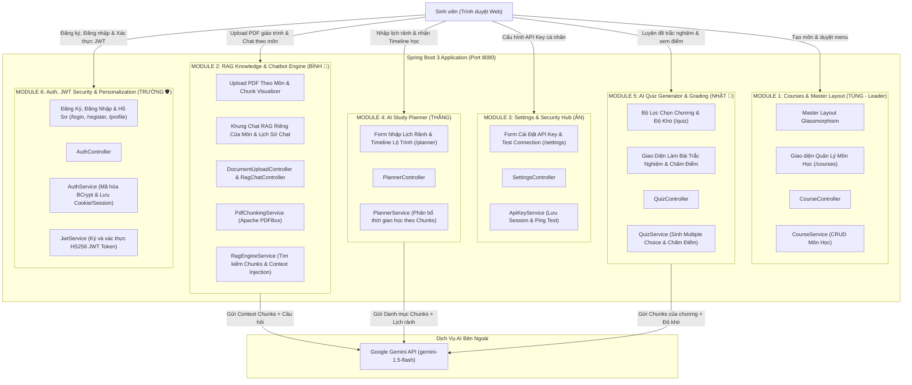

# 05. KIẾN TRÚC HỆ THỐNG & ĐẶC TẢ 5 MODULE ĐỘC LẬP (FEATURES & ARCHITECTURE)
**Dự án**: **Smart Multi-Course Study Hub & RAG AI**  
**Nhóm thực hiện**: Tùng (Leader), Bình, Nhật, Thắng, Ân, Trường  

Tài liệu này mô tả chi tiết kiến trúc kỹ thuật và đặc tả 5 Module độc lập hoàn toàn của hệ thống.

---

## 🏛️ 1. KIẾN TRÚC TỔNG THỂ HỆ THỐNG (SYSTEM ARCHITECTURE)

Hệ thống được chia thành **5 Module chức năng độc lập (Domain-Driven Modules)** kết hợp dịch vụ ngoài **Google Gemini API**:

---

## 🌐 2. ĐẶC TẢ CHI TIẾT 5 MODULE ĐỘC LẬP TỪ A - Z

---

### 🔹 MODULE 1: QUẢN LÝ MÔN HỌC & MASTER LAYOUT (TÙNG - LEADER)
* **Các Endpoint**: `GET /courses`, `POST /courses/create`, `GET /courses/delete/{id}`
* **Mô tả**: Quản lý toàn bộ danh mục môn học của sinh viên và cung cấp khung layout cho toàn web.
* **Front-end**:
  * Master Layout (`layout.html`): Thanh Navbar chuyển theme Dark/Light, Sidebar menu trượt, Footer bản quyền.
  * Trang Quản lý Môn học (`courses.html`):
    * Form tạo môn học mới (Mã môn, Tên môn, Mô tả, Chọn màu/icon).
    * Lưới hiển thị các thẻ Card môn học đã tạo, có nút: "Xem giáo trình & Chat", "Lập kế hoạch học", "Luyện đề", "Xóa".
* **Back-end**:
  * `Course.java`, `CourseController.java`, `CourseService.java` (lưu trữ danh sách môn học trong H2 Database bền vững).

---

### 🌟 MODULE 2: HỆ THỐNG RAG CHATBOT - TÀI LIỆU, CHUNKING & CHAT GIÁO TRÌNH (BÌNH)
* **Các Endpoint**: 
  * `GET /courses/{courseId}/documents`: Xem tài liệu và chunk của môn.
  * `POST /courses/{courseId}/upload`: Upload file PDF vào môn học.
  * `GET /courses/{courseId}/chat`: Vào phòng chat RAG của môn học đó.
  * `POST /courses/{courseId}/chat/send`: Gửi câu hỏi chat với giáo trình.
* **Mô tả**: Toàn bộ luồng RAG khép kín do Bình làm chủ từ A-Z.
* **Front-end**:
  * Form kéo-thả (Drag & Drop Zone) upload file PDF giáo trình vào môn học.
  * Bảng danh sách các tài liệu PDF đã tải lên của môn đó.
  * **Trình trực quan hóa Chunk (Chunk Visualizer)**: Accordion xổ ra từng đoạn `#Chunk 1`, `#Chunk 2`... kèm số từ.
  * **Khung Chat RAG theo môn**: Cửa sổ chat riêng của môn học, hiển thị toàn bộ lịch sử trò chuyện của môn đó.
* **Back-end**:
  * Thư viện **Apache PDFBox** đọc text từ file PDF.
  * `PdfChunkingService`: Cắt văn bản thành các Chunks (300-500 từ) lưu kèm `courseId`.
  * `RagEngineService`: Tìm các chunk liên quan của môn học, đưa vào Prompt gửi sang Gemini để AI trả lời bám sát giáo trình.
  * Lưu trữ lịch sử chat của phiên RAG theo `courseId`.

---

### 🔹 MODULE 3: CÀI ĐẶT & BẢO MẬT API KEY (ÂN)
* **Các Endpoint**: `GET /settings`, `POST /settings/save`, `POST /settings/test-ping` (alias `/settings/test-connection`), `POST /settings/clear`
* **Mô tả**: Quản lý API Key cá nhân đa nhà cung cấp (Google Gemini, Groq, OpenAI), kiểm tra kết nối AI với đo độ trễ mạng thực tế (`latencyMs`), cách ly theo `HttpSession` an toàn tuyệt đối.
* **Front-end (`templates/settings/index.html`)**:
  * Form nhập API Key có nút con mắt toggle ẩn/hiện key và token chống CSRF.
  * Dropdown chọn Provider: Google Gemini (`gemini-1.5-flash`), Groq Cloud (`llama-3.3-70b-versatile`), hoặc OpenAI (`gpt-4o-mini`).
  * Nút **"Kiểm tra kết nối"** (`/settings/test-ping`): Gửi câu thử nghiệm nhỏ đo độ trễ phản hồi (`latencyMs`), hiển thị badge xanh/đỏ trực quan.
  * Hộp Alert DaisyUI thông báo trạng thái chi tiết, mã lỗi HTTP được dịch sang tiếng Việt thân thiện.
  * Nút **"Lưu cấu hình"** và nút **"Xóa key đã lưu"** (chỉ xóa key AI trong session, tự động dọn dẹp khi đăng xuất).
* **Back-end**:
  * `SettingsController.java`: Điều hướng giao diện và tiếp nhận AJAX/Form actions.
  * `ApiKeyService.java`: Tra cứu key, gọi HTTP ping test với timeout kết nối 5s / đọc 15s, xử lý lỗi mạng mượt mà.
  * `SettingsSecurityConfig.java`: Cấu hình ưu tiên riêng cho route `/settings/**` tương thích hoàn hảo giữa Spring Security OAuth2 và `JwtAuthInterceptor`.
  * **Bảo mật tuyệt đối**: Key chỉ nằm trong RAM `HttpSession` (`SESSION_PROVIDER_API_KEY`), không lưu cứng vào database, file hay cookie, không in log key.

---

### 🔹 MODULE 4: AI STUDY PLANNER - LẬP KẾ HOẠCH HỌC TẬP VỪA SỨC (THẮNG)
* **Các Endpoint**: 
  * `GET /planner`: Hiển thị form lập kế hoạch.
  * `POST /planner/generate`: Gửi thông tin để AI sinh Timeline học tập.
* **Mô tả**: Phân bổ học mới, ôn tập và luyện đề theo thời gian rảnh thực tế của sinh viên và khối lượng tài liệu giáo trình.
* **Front-end (`planner.html`)**:
  * **Cột trái (Input Form)**:
    * Dropdown chọn Môn học.
    * Ô nhập Số giờ mỗi tuần (ví dụ: 6 tiếng).
    * Các nút bấm chọn Ngày rảnh trong tuần: `[Thứ 2]`, `[Thứ 3]`, `[Thứ 4]`, `[Thứ 5]`, `[Thứ 6]`, `[Thứ 7]`, `[Chủ nhật]`.
    * Ô chọn Ngày nghỉ & Ngày thi cuối kỳ.
    * Ô nhập Mục tiêu học tập (ví dụ: *"Nắm chắc lý thuyết và làm được bài CRUD hoàn chỉnh"*).
    * Nút bấm: **[Tạo kế hoạch với Gemini]**.
  * **Cột phải (Output Timeline)**:
    * Hiển thị lộ trình Timeline từng ngày/tuần bằng **DaisyUI Timeline / Steps Component**.
* **Back-end**:
  * `PlannerController.java`, `PlannerService.java`.
  * Đọc danh mục các bài học từ Chunks của môn học (từ Module 2 của Bình) + thông tin ngày rảnh ➔ Gửi sang Gemini API với System Prompt chuyên gia lập kế hoạch ➔ Trả về lộ trình Timeline theo cấu trúc JSON.

---

### 🚀 MODULE 5: TỰ ĐỘNG TẠO ĐỀ THI TRẮC NGHIỆM THEO CHƯƠNG (NHẬT)
* **Các Endpoint**: 
  * `GET /quiz`: Giao diện chọn bộ lọc đề thi.
  * `POST /quiz/generate`: Tạo đề thi trắc nghiệm bằng AI.
  * `POST /quiz/submit`: Nộp bài thi và nhận kết quả chấm điểm.
* **Mô tả**: Sinh viên tự kiểm tra kiến thức trước khi đi thi thật, dựa trên đúng tài liệu giáo trình đã nạp vào môn học.
* **Front-end (`quiz.html`)**:
  * **Bộ lọc cá nhân hóa**: Chọn Môn học, Chọn Chương/Tài liệu muốn kiểm tra, Chọn Độ khó (Dễ/Trung bình/Khó), Chọn số lượng câu hỏi (5 hoặc 10 câu).
  * **Giao diện Làm Bài Thi**: Từng câu hỏi hiển thị 4 đáp án lựa chọn A/B/C/D qua radio buttons.
  * **Chấm điểm tức thì**: Bấm "Nộp Bài" ➔ Hệ thống tự chấm điểm (ví dụ: 8/10), tô xanh câu đúng, tô đỏ câu sai và mở khung trích dẫn giải thích từ giáo trình.
* **Back-end**:
  * `QuizController.java`, `QuizService.java`: Gọi Gemini API đọc Chunks của chương đó để sinh JSON Multiple Choice, chấm điểm và trả về kết quả.

---

### 🛡️ MODULE 6: XÁC THỰC, JWT SECURITY & CÁ NHÂN HÓA NGƯỜI DÙNG (TRƯỜNG)
* **Các Endpoint**:
  * `GET /login`, `POST /login`: Đăng nhập sinh viên, mã hóa mật khẩu, sinh JWT Token lưu vào HttpOnly Cookie và Session.
  * `GET /register`, `POST /register`: Đăng ký tài khoản sinh viên mới, băm mật khẩu an toàn bằng BCrypt.
  * `GET /profile`: Trang hồ sơ cá nhân hiển thị avatar, email, vai trò (ROLE_STUDENT) và trạng thái JWT Token.
  * `GET /logout`: Đăng xuất an toàn, xóa Cookie JWT và hủy Session.
* **Mô tả**: Đảm bảo hệ thống có cơ chế xác thực danh tính cá nhân hóa cho từng sinh viên, giúp mỗi bạn có không gian học tập riêng biệt, không bị lẫn lộn dữ liệu khóa học hay lịch sử hỏi đáp.
* **Front-end (`login.html`, `register.html`, `profile.html`)**:
  - Giao diện Glassmorphism hiện đại, responsive đầy đủ trên điện thoại và máy tính.
  - Hỗ trợ nút con mắt toggle ẩn/hiện mật khẩu và hiển thị sẵn tài khoản demo (`student` / `123456`).
* **Back-end**:
  - `User.java`: Entity người dùng trong database H2.
  - `UserRepository.java`: Thao tác JPA tìm kiếm theo username và email.
  - `JwtService.java`: Sử dụng thư viện JJWT 0.12.x với thuật toán HMAC-SHA256 để ký số và giải mã token.
  - `AuthService.java`: Thuật toán băm mật khẩu BCrypt chống tấn công từ điển, quản lý đăng nhập/đăng ký.
  - `AuthController.java`: Quản lý điều hướng và vòng đời Cookie/Session.

---

## 👑 3. VAI TRÒ TỔNG QUAN QA & TÀI LIỆU CỦA TRƯỜNG
* **Trường** là người chịu trách nhiệm tổng thể về chất lượng đầu ra:
  1. Chủ biên cuốn **User Guide (Word/PDF)** hoàn chỉnh (gồm đủ 5 module và báo cáo thực nghiệm AI của cả 5 bạn).
  2. Thiết kế bộ **Slide PowerPoint (12 - 15 trang)** chuẩn đẹp, trực quan.
  3. Đảm nhận vai trò **Master QA Tester**: Chạy thử kết nối xuyên suốt cả 5 module (*Tạo môn của Tùng ➔ Cài key của Ân ➔ Upload PDF giáo trình & Chat RAG của Bình ➔ Lập kế hoạch Study Planner của Thắng ➔ Thi thử trắc nghiệm của Nhật*).
  4. Chuẩn bị sẵn 2 file PDF bài giảng mẫu để demo trước giảng viên.
  5. Làm MC mở đầu và kết luận buổi bảo vệ trước giảng viên.
