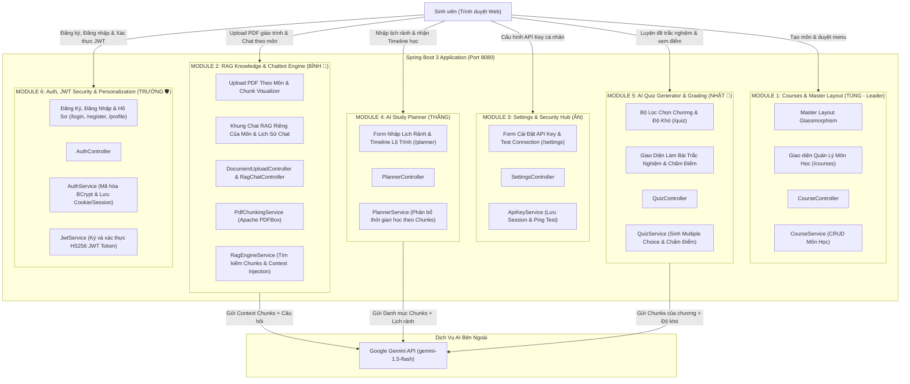

# 05. KIẾN TRÚC HỆ THỐNG & ĐẶC TẢ 5 MODULE ĐỘC LẬP (FEATURES & ARCHITECTURE)
**Dự án**: **Smart Multi-Course Study Hub & RAG AI**  
**Nhóm thực hiện**: Tùng (Leader), Bình, Nhật, Thắng, Ân, Trường  

Tài liệu này mô tả chi tiết kiến trúc kỹ thuật và đặc tả 5 Module độc lập hoàn toàn của hệ thống.

---

## 🏛️ 1. KIẾN TRÚC TỔNG THỂ HỆ THỐNG (SYSTEM ARCHITECTURE)

Hệ thống được chia thành **5 Module chức năng độc lập (Domain-Driven Modules)** kết hợp dịch vụ ngoài **Google Gemini API**:

---

## 🌐 2. ĐẶC TẢ CHI TIẾT 5 MODULE ĐỘC LẬP TỪ A - Z

---

### 🔹 MODULE 1: QUẢN LÝ MÔN HỌC, PHÂN LẬP DỮ LIỆU & MASTER LAYOUT (TÙNG - LEADER)
* **Các Endpoint**: `GET /courses`, `POST /courses/create`, `GET /courses/edit/{id}`, `POST /courses/edit/{id}`, `GET /courses/delete/{id}`, `GET /courses/{id}`
* **Mô tả**: Quản lý danh mục môn học cá nhân hóa cho từng sinh viên, phân lập dữ liệu tuyệt đối (Data Isolation), kiểm soát hạn ngạch gói cước (Quota Enforcement) và cung cấp khung Master Layout Glassmorphism toàn hệ thống.
* **Front-end**:
  * Master Layout (`layout.html`): Thanh Navbar chuyển theme Dark/Light, hiển thị Badge gói cước (`FREE`, `PRO`, `SQUAD`), Sidebar menu trượt, Footer bản quyền. Tách biệt hoàn toàn giao diện giữa Sinh viên (`ROLE_STUDENT`) và Quản trị viên (`ROLE_ADMIN`).
  * Modal Bảng Giá 3 Gói Cước (`pricing-modal`): Cho phép sinh viên xem nhanh quyền lợi 3 gói `FREE`, `PRO` ($2/tháng), và `SQUAD` ($5/tháng - nhóm 5 bạn).
  * Trang Quản lý Môn học (`courses.html` & `index.html`):
    * Form tạo môn học mới (Mã môn, Tên môn, Mô tả, Chọn màu/icon).
    * Kiểm tra hạn ngạch trực quan: Tự động vô hiệu hóa nút "Tạo môn học" khi tài khoản FREE đã tạo đủ 3 môn cá nhân kèm tooltip cảnh báo.
    * Lưới hiển thị các thẻ Card môn học đã tạo của riêng người dùng đang đăng nhập, kèm nút: "Xem giáo trình & Chat", "Lập kế hoạch học", "Luyện đề", "Xóa".
* **Back-end**:
  * `Course.java`: Thực thể môn học ánh xạ `@ManyToOne(fetch = FetchType.LAZY) User user` (`user_id`). Ràng buộc khóa tổng hợp `uk_courses_user_code(user_id, code)` cho phép các sinh viên khác nhau tạo cùng mã môn (vd: `HSF302`).
  * `CourseRepository.java`: Truy vấn lọc theo `user_id` (`findAllByUserId`, `countByUserId`, `existsByCodeIgnoreCaseAndUserId`).
  * `CourseService.java`: Triển khai Data Isolation `getAllCoursesWithStats(keyword, semester, currentUser)` chỉ trả về môn học thuộc sở hữu của người dùng hiện tại (Admin xem toàn bộ). Kiểm soát hạn mức tối đa 3 môn học cho gói Free.
  * `CourseController.java`: Kiểm tra quyền sở hữu nghiêm ngặt trước khi Sửa/Xóa môn học (`SecurityException` nếu cố tình can thiệp môn của người khác).
  * Điều hướng thông minh: Tự động chuyển hướng Quản trị viên sang `/admin/dashboard` khi truy cập trang chủ.

---

### 🌟 MODULE 2: HỆ THỐNG RAG CHATBOT - TÀI LIỆU, CHUNKING & CHAT GIÁO TRÌNH (BÌNH)
* **Các Endpoint**: 
  * `GET /courses/{courseId}/documents`: Xem tài liệu và chunk của môn.
  * `POST /courses/{courseId}/upload`: Upload file PDF vào môn học.
  * `GET /courses/{courseId}/chat`: Vào phòng chat RAG của môn học đó.
  * `POST /courses/{courseId}/chat/send`: Gửi câu hỏi chat với giáo trình.
* **Mô tả**: Toàn bộ luồng RAG khép kín do Bình làm chủ từ A-Z.
* **Front-end**:
  * Form kéo-thả (Drag & Drop Zone) upload file PDF giáo trình vào môn học.
  * Bảng danh sách các tài liệu PDF đã tải lên của môn đó.
  * **Trình trực quan hóa Chunk (Chunk Visualizer)**: Accordion xổ ra từng đoạn `#Chunk 1`, `#Chunk 2`... kèm số từ.
  * **Khung Chat RAG theo môn**: Cửa sổ chat riêng của môn học, hiển thị toàn bộ lịch sử trò chuyện của môn đó.
* **Back-end**:
  * Thư viện **Apache PDFBox** đọc text từ file PDF.
  * `PdfChunkingService`: Cắt văn bản thành các Chunks (300-500 từ) lưu kèm `courseId`.
  * `RagEngineService`: Tìm các chunk liên quan của môn học, đưa vào Prompt gửi sang Gemini để AI trả lời bám sát giáo trình.
  * Lưu trữ lịch sử chat của phiên RAG theo `courseId`.

---

### 🔹 MODULE 3: ADMIN COMMAND CENTER & HỆ THỐNG CÀI ĐẶT (ÂN)
* **Các Endpoint**: 
  * `GET /admin/dashboard`: Trung tâm chỉ huy, giám sát 4 KPI và phân bổ 3 gói cước.
  * `GET /admin/users`: Quản lý danh sách sinh viên, cấp phát gói cước và hạn ngạch RAG.
  * `POST /admin/users/{id}/tier`: Nâng/hạ gói cước sinh viên 1-Click (`FREE`, `PRO`, `SQUAD`).
  * `POST /admin/users/{id}/reset-rag`: Reset hạn ngạch RAG trong ngày của sinh viên về 0.
  * `GET /admin/settings`, `POST /admin/settings/ping`: Quản lý và kiểm tra kết nối System Gemini API Key.
* **Mô tả**: Trung tâm chỉ huy điều hành toàn bộ hệ thống dành cho Quản trị viên (`ROLE_ADMIN`), cung cấp công cụ quản trị người dùng, hạn ngạch gói cước và giám sát hoạt động AI.
* **Front-end (`templates/admin/`)**:
  * Dashboard KPI thời gian thực: 4 thẻ thống kê (Tổng tài khoản phân bổ 3 gói, Tổng môn học hệ thống, Dung lượng Chunks giáo trình, Lượt RAG trong ngày).
  * Giao diện Quản lý Sinh viên: Bảng danh sách sinh viên trực quan, bộ nút 1-Click nâng PRO / SQUAD, hạ FREE, và nút Reset RAG tức thì.
  * Cấu hình System Key: Hiển thị key che mờ (`AIzaSy...xxxx`), nút Ping đo độ trễ mạng thực tế (`latencyMs`).
  * Layout quản trị độc lập: Thanh Navbar và Sidebar riêng biệt, loại bỏ hoàn toàn các liên kết chức năng sinh viên.
* **Back-end**:
  * `AdminDashboardController.java`: Cung cấp số liệu thống kê tổng hợp và KPI cho Dashboard.
  * `AdminUserController.java`: Xử lý nâng hạ gói cước 1-Click và reset hạn ngạch người dùng.
  * `SystemAiKeyService.java`: Quản lý System Key trong bộ nhớ máy chủ, hỗ trợ fallback từ biến môi trường `GEMINI_API_KEY`.
  * `AdminSecurityConfig`: Phân quyền chặt chẽ yêu cầu `ROLE_ADMIN` và kiểm tra CSRF token trên mọi thao tác POST.

---

### 🔹 MODULE 4: AI STUDY PLANNER - LẬP KẾ HOẠCH HỌC TẬP VỪA SỨC (THẮNG)
* **Các Endpoint**: 
  * `GET /planner`: Hiển thị form lập kế hoạch.
  * `POST /planner/generate`: Gửi thông tin để AI sinh Timeline học tập.
* **Mô tả**: Phân bổ học mới, ôn tập và luyện đề theo thời gian rảnh thực tế của sinh viên và khối lượng tài liệu giáo trình.
* **Front-end (`planner.html`)**:
  * **Cột trái (Input Form)**:
    * Dropdown chọn Môn học.
    * Ô nhập Số giờ mỗi tuần (ví dụ: 6 tiếng).
    * Các nút bấm chọn Ngày rảnh trong tuần: `[Thứ 2]`, `[Thứ 3]`, `[Thứ 4]`, `[Thứ 5]`, `[Thứ 6]`, `[Thứ 7]`, `[Chủ nhật]`.
    * Ô chọn Ngày nghỉ & Ngày thi cuối kỳ.
    * Ô nhập Mục tiêu học tập (ví dụ: *"Nắm chắc lý thuyết và làm được bài CRUD hoàn chỉnh"*).
    * Nút bấm: **[Tạo kế hoạch với Gemini]**.
  * **Cột phải (Output Timeline)**:
    * Hiển thị lộ trình Timeline từng ngày/tuần bằng **DaisyUI Timeline / Steps Component**.
* **Back-end**:
  * `PlannerController.java`, `PlannerService.java`.
  * Đọc danh mục các bài học từ Chunks của môn học (từ Module 2 của Bình) + thông tin ngày rảnh ➔ Gửi sang Gemini API với System Prompt chuyên gia lập kế hoạch ➔ Trả về lộ trình Timeline theo cấu trúc JSON.

---

### 🚀 MODULE 5: TỰ ĐỘNG TẠO ĐỀ THI TRẮC NGHIỆM THEO CHƯƠNG (NHẬT)
* **Các Endpoint**: 
  * `GET /quiz`: Giao diện chọn bộ lọc đề thi.
  * `POST /quiz/generate`: Tạo đề thi trắc nghiệm bằng AI.
  * `POST /quiz/submit`: Nộp bài thi và nhận kết quả chấm điểm.
* **Mô tả**: Sinh viên tự kiểm tra kiến thức trước khi đi thi thật, dựa trên đúng tài liệu giáo trình đã nạp vào môn học.
* **Front-end (`quiz.html`)**:
  * **Bộ lọc cá nhân hóa**: Chọn Môn học, Chọn Chương/Tài liệu muốn kiểm tra, Chọn Độ khó (Dễ/Trung bình/Khó), Chọn số lượng câu hỏi (5 hoặc 10 câu).
  * **Giao diện Làm Bài Thi**: Từng câu hỏi hiển thị 4 đáp án lựa chọn A/B/C/D qua radio buttons.
  * **Chấm điểm tức thì**: Bấm "Nộp Bài" ➔ Hệ thống tự chấm điểm (ví dụ: 8/10), tô xanh câu đúng, tô đỏ câu sai và mở khung trích dẫn giải thích từ giáo trình.
* **Back-end**:
  * `QuizController.java`, `QuizService.java`: Gọi Gemini API đọc Chunks của chương đó để sinh JSON Multiple Choice, chấm điểm và trả về kết quả.

---

### 🛡️ MODULE 6: XÁC THỰC, JWT SECURITY & QUẢN LÝ NHÓM STUDY SQUAD (TRƯỜNG)
* **Các Endpoint**:
  * `GET /login`, `POST /login`: Đăng nhập người dùng, mã hóa mật khẩu, tự động điều hướng Admin sang Dashboard, sinh JWT Token lưu vào HttpOnly Cookie và Session.
  * `GET /register`, `POST /register`: Đăng ký tài khoản sinh viên mới, băm mật khẩu an toàn bằng BCrypt, gán mặc định gói FREE.
  * `GET /profile`: Hồ sơ cá nhân hiển thị avatar, email, role, gói cước hiện tại (`FREE`, `PRO`, `SQUAD`), và khu vực Quản lý Nhóm Học Tập Study Squad.
  * `POST /profile/squad/add-member`, `POST /profile/squad/remove-member`: Thêm/xóa thành viên nhóm học tập (tối đa 5 bạn).
  * `GET /logout`: Đăng xuất an toàn, xóa Cookie JWT và hủy Session.
* **Mô tả**: Xác thực danh tính cá nhân hóa cho từng sinh viên kết hợp quản lý phân quyền và gói cước Study Squad dành cho nhóm học tập 5 thành viên.
* **Front-end (`login.html`, `register.html`, `profile.html`)**:
  - Giao diện Glassmorphism hiện đại, responsive đầy đủ trên thiết bị di động và máy tính để bàn.
  - Khu vực Study Squad trên `profile.html`: Dành riêng cho nhóm trưởng gói SQUAD để quản lý danh sách tối đa 4 thành viên cùng hưởng đặc quyền PRO.
* **Back-end**:
  - `User.java`: Lưu trữ tài khoản, vai trò (`role`), gói cước (`subscription_tier`), số lượt RAG trong ngày (`daily_rag_count`), và nhóm trưởng (`squad_leader_username`).
  - `UserRepository.java`: Tìm kiếm theo username, email, và danh sách thành viên squad (`findBySquadLeaderUsername`).
  - `JwtService.java`: Sử dụng thư viện JJWT 0.12.x với thuật toán HMAC-SHA256 để ký số và giải mã token.
  - `AuthService.java`: Quản lý đăng nhập, đăng ký, băm mật khẩu BCrypt, và logic thêm/xóa thành viên nhóm Study Squad.
  - `AuthController.java`: Điều hướng thông minh dựa trên vai trò (Admin -> `/admin/dashboard`, Student -> `/courses`).

---

## 👑 3. VAI TRÒ TỔNG QUAN QA & TÀI LIỆU CỦA TRƯỜNG
* **Trường** là người chịu trách nhiệm tổng thể về chất lượng đầu ra:
  1. Chủ biên cuốn **User Guide (Word/PDF)** hoàn chỉnh (gồm đủ 5 module và báo cáo thực nghiệm AI của cả 5 bạn).
  2. Thiết kế bộ **Slide PowerPoint (12 - 15 trang)** chuẩn đẹp, trực quan.
  3. Đảm nhận vai trò **Master QA Tester**: Chạy thử kết nối xuyên suốt cả 5 module (*Tạo môn của Tùng ➔ Cài key của Ân ➔ Upload PDF giáo trình & Chat RAG của Bình ➔ Lập kế hoạch Study Planner của Thắng ➔ Thi thử trắc nghiệm của Nhật*).
  4. Chuẩn bị sẵn 2 file PDF bài giảng mẫu để demo trước giảng viên.
  5. Làm MC mở đầu và kết luận buổi bảo vệ trước giảng viên.
