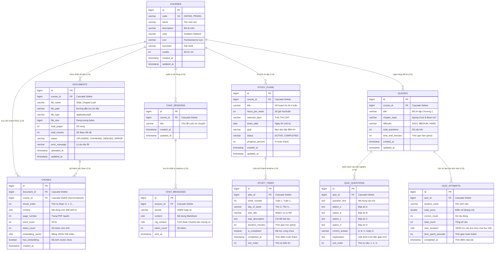

# 09. THIẾT KẾ DATABASE SCHEMA TOÀN DIỆN & VỮNG CHẮC (DATABASE SPECIFICATION)
**Môn học**: HSF302 - JPA and Spring Framework (FPT University)  
**Đề tài**: **Smart Multi-Course Study Hub & RAG AI**  
**Hệ quản trị CSDL**: H2 Database (Engine: File-based `./data/studyhubdb`, Chế độ xem: H2 Web Console)  
**ORM Framework**: Spring Data JPA & Hibernate 6.5+ (Spring Boot 3.3.4)  
**Tác giả**: Leader Tùng (Tổng công trình sư dữ liệu nhóm)

---

## 🎯 TRIẾT LÝ THIẾT KẾ (DESIGN PRINCIPLES)

Để xây dựng một CSDL **thật vững, thật chi tiết và hạn chế tối đa việc phải đập đi xây lại**, schema này được thiết kế theo 5 nguyên tắc vàng:

1. **Chuẩn hóa 3NF kết hợp Denormalization có chủ đích**:
   - Mọi thực thể liên quan mật thiết với nhau (Course $\rightarrow$ Documents, StudyPlans, Quizzes, ChatSessions).
   - *Denormalization thông minh*: Riêng bảng `chunks`, chúng ta lưu cả `document_id` và `course_id`. Khi thực hiện thuật toán RAG Vector Search theo môn học, hệ thống chỉ cần lọc `WHERE course_id = ?` mà **không cần JOIN** sang bảng `documents`, giúp tốc độ truy vấn vector đạt mức mili-giây.
2. **Cascade Delete triệt để (Zero-Orphan Records)**:
   - Mọi bảng con đều được cấu hình `@OnDelete(action = OnDeleteAction.CASCADE)` ở mức CSDL và JPA. Khi Leader Tùng xóa một Môn học (`Course`), toàn bộ tài liệu PDF, các đoạn văn bản Chunks, lịch sử Chatbot RAG, Kế hoạch học tập và Bài thi trắc nghiệm đều được CSDL tự động dọn sạch bóng, không để lại dữ liệu rác và không bao giờ bị lỗi `DataIntegrityViolationException`.
3. **Chống tràn dữ liệu văn bản & Vector bằng CLOB / TEXT**:
   - Nội dung tài liệu PDF, lời giải thích AI, vector embedding 768 chiều và lịch sử Markdown đều được khai báo kiểu `@Lob` / `CLOB` / `TEXT`. Tuyệt đối không dùng `VARCHAR(255)` tránh lỗi vỡ độ dài khi nạp tài liệu thực tế.
4. **Đánh chỉ mục (Index Strategy)**:
   - Mọi cột khóa ngoại (`course_id`, `document_id`, `session_id`, `plan_id`, `quiz_id`) đều có `@Index` để tối ưu câu lệnh `SELECT WHERE foreign_key = ?` với chi phí $O(\log N)$.
5. **Kiến trúc Repositories có sẵn 100%**:
   - Tạo sẵn toàn bộ 10 Spring Data JPA Repository Interfaces với đầy đủ các hàm truy vấn thường dùng nhất, các bạn dev chỉ việc inject vào Service và sử dụng.

---

## 📊 1. SƠ ĐỒ THỰC THỂ QUAN HỆ (ERD - MERMAID DIAGRAM)



---

## 🗄️ 2. CHI TIẾT TỪNG BẢNG & LÝ GIẢI KỸ THUẬT

---

### 1️⃣ BẢNG `courses` & `chunks` (Dữ Liệu Nền Tảng Dùng Chung - TÙNG & CORE)
- **Package**: `com.group2.assignment.core`
- **File Entities**: [`Course.java`](file:///d:/Ki5_Fall_2026/HSF302/Assignment/Assignment/src/main/java/com/tung/assignment/core/entity/Course.java), [`Chunk.java`](file:///d:/Ki5_Fall_2026/HSF302/Assignment/Assignment/src/main/java/com/tung/assignment/core/entity/Chunk.java)
- **Repositories**: [`CourseRepository.java`](file:///d:/Ki5_Fall_2026/HSF302/Assignment/Assignment/src/main/java/com/tung/assignment/core/repository/CourseRepository.java), [`ChunkRepository.java`](file:///d:/Ki5_Fall_2026/HSF302/Assignment/Assignment/src/main/java/com/tung/assignment/core/repository/ChunkRepository.java)
- **Controller & Service**: [`CourseService.java`](file:///d:/Ki5_Fall_2026/HSF302/Assignment/Assignment/src/main/java/com/tung/assignment/core/service/CourseService.java), [`HomeController.java`](file:///d:/Ki5_Fall_2026/HSF302/Assignment/Assignment/src/main/java/com/tung/assignment/core/controller/HomeController.java)
- **Vai trò**: Bảng gốc trung tâm (Root Entity) và kho lưu trữ vector chunks dùng chung cho cả RAG (Bình), Study Planner (Thắng) và Quiz Generator (Nhật).

| Cột (Bảng `courses`) | Kiểu dữ liệu | Ràng buộc | Mục đích & Giải thích kỹ thuật |
|:---|:---|:---|:---|
| `id` | `BIGINT` | PRIMARY KEY, AUTO_INCREMENT | Khóa chính tự tăng |
| `code` | `VARCHAR(50)` | NOT NULL, UNIQUE, INDEX | Mã môn học chuẩn (HSF302, MAS291). Đánh Unique Index ngăn chặn tạo trùng môn |
| `name` | `VARCHAR(200)` | NOT NULL | Tên môn học đầy đủ |
| `description` | `VARCHAR(1000)`| NULL | Tóm tắt mục tiêu môn học |
| `color` | `VARCHAR(100)` | DEFAULT `'from-indigo-600 to-purple-600'` | Class gradient Tailwind tạo phong cách Glassmorphism đồng nhất |
| `icon` | `VARCHAR(50)` | DEFAULT `'fa-book-open'` | FontAwesome icon hiển thị trên card |
| `semester` | `VARCHAR(50)` | DEFAULT `'Fall 2026'` | Học kỳ giảng dạy |
| `credits` | `INT` | DEFAULT `3` | Số tín chỉ của môn học |
| `created_at` | `TIMESTAMP` | NOT NULL | Thời điểm khởi tạo |
| `updated_at` | `TIMESTAMP` | NOT NULL | Thời điểm cập nhật cuối cùng |

| Cột (Bảng `chunks`) | Kiểu dữ liệu | Ràng buộc | Mục đích & Giải thích kỹ thuật |
|:---|:---|:---|:---|
| `id` | `BIGINT` | PRIMARY KEY, AUTO_INCREMENT | Khóa chính tự tăng |
| `document_id` | `BIGINT` | NOT NULL, FK, INDEX, CASCADE | Thuộc file tài liệu nào. Xóa document $\rightarrow$ xóa sạch chunks |
| `course_id` | `BIGINT` | NOT NULL, FK, INDEX, CASCADE | **Denormalized**: Khóa ngoại trỏ trực tiếp đến `courses`. Giúp RAG truy vấn cực nhanh theo môn |
| `chunk_index` | `INT` | NOT NULL | Thứ tự đoạn trong file: 0, 1, 2... |
| `content` | `CLOB` | NOT NULL | Nội dung văn bản (300-500 từ). Dùng CLOB để không bị giới hạn ký tự |
| `page_number` | `INT` | DEFAULT `1` | Số trang PDF gốc. Dùng hiển thị trích dẫn Citation chính xác: *"Trích từ trang 14"* |
| `word_count` | `INT` | DEFAULT `0` | Số lượng từ trong đoạn |
| `token_count` | `INT` | DEFAULT `0` | Số lượng token ước tính (hỗ trợ kiểm soát budget prompt AI) |
| `embedding_vector` | `CLOB` | NULL | Mảng JSON float 768 chiều `[0.012, -0.045, ...]` do `text-embedding-004` trả về |
| `has_embedding` | `BOOLEAN` | DEFAULT `FALSE`, INDEX | Cờ kiểm tra đoạn này đã được sinh vector thành công chưa |
| `created_at` | `TIMESTAMP` | NOT NULL | Thời điểm tạo |

---

### 2️⃣ BẢNG `documents`, `chat_sessions` & `chat_messages` (RAG Engine - BÌNH)
- **Package**: `com.group2.assignment.rag`
- **File Entities**: [`Document.java`](file:///d:/Ki5_Fall_2026/HSF302/Assignment/Assignment/src/main/java/com/tung/assignment/rag/entity/Document.java), [`ChatSession.java`](file:///d:/Ki5_Fall_2026/HSF302/Assignment/Assignment/src/main/java/com/tung/assignment/rag/entity/ChatSession.java), [`ChatMessage.java`](file:///d:/Ki5_Fall_2026/HSF302/Assignment/Assignment/src/main/java/com/tung/assignment/rag/entity/ChatMessage.java)
- **Repositories**: [`DocumentRepository.java`](file:///d:/Ki5_Fall_2026/HSF302/Assignment/Assignment/src/main/java/com/tung/assignment/rag/repository/DocumentRepository.java), [`ChatSessionRepository.java`](file:///d:/Ki5_Fall_2026/HSF302/Assignment/Assignment/src/main/java/com/tung/assignment/rag/repository/ChatSessionRepository.java), [`ChatMessageRepository.java`](file:///d:/Ki5_Fall_2026/HSF302/Assignment/Assignment/src/main/java/com/tung/assignment/rag/repository/ChatMessageRepository.java)
- **Vai trò**: Quản lý file PDF tải lên và các phiên trò chuyện hỏi đáp tài liệu bám sát trích dẫn Citations.

| Cột (Bảng `documents`) | Kiểu dữ liệu | Ràng buộc | Mục đích & Giải thích kỹ thuật |
|:---|:---|:---|:---|
| `id` | `BIGINT` | PRIMARY KEY, AUTO_INCREMENT | Khóa chính tự tăng |
| `course_id` | `BIGINT` | NOT NULL, FK, INDEX, CASCADE | Liên kết với môn học. Khi xóa môn học, tài liệu tự động bị xóa |
| `file_name` | `VARCHAR(255)` | NOT NULL | Tên file gốc người dùng tải lên (Slide_Chapter1.pdf) |
| `file_path` | `VARCHAR(500)` | NULL | Đường dẫn file lưu trên ổ đĩa vật lý của server |
| `file_type` | `VARCHAR(50)` | DEFAULT `'application/pdf'` | Định dạng MIME của file |
| `file_size` | `BIGINT` | NULL | Dung lượng file tính bằng bytes |
| `total_pages` | `INT` | DEFAULT `0` | Tổng số trang PDF do Apache PDFBox trích xuất |
| `total_chunks` | `INT` | DEFAULT `0` | Số đoạn văn bản đã được cắt sau thuật toán Chunking |
| `status` | `VARCHAR(30)` | DEFAULT `'UPLOADED'`, INDEX | Trạng thái xử lý: `UPLOADED`, `CHUNKING`, `INDEXED`, `ERROR` |
| `error_message`| `VARCHAR(1000)`| NULL | Lưu thông điệp lỗi nếu file hỏng hoặc lỗi trích xuất text |
| `uploaded_at` | `TIMESTAMP` | NOT NULL | Thời điểm tải lên |
| `updated_at` | `TIMESTAMP` | NOT NULL | Thời điểm hoàn tất xử lý |

---

### 3️⃣ BẢNG `study_plans` & `study_tasks` (Lập Kế Hoạch Học Tập Vừa Sức - THẮNG)
- **Package**: `com.group2.assignment.planner`
- **File Entities**: [`StudyPlan.java`](file:///d:/Ki5_Fall_2026/HSF302/Assignment/Assignment/src/main/java/com/tung/assignment/planner/entity/StudyPlan.java), [`StudyTask.java`](file:///d:/Ki5_Fall_2026/HSF302/Assignment/Assignment/src/main/java/com/tung/assignment/planner/entity/StudyTask.java)
- **Repositories**: [`StudyPlanRepository.java`](file:///d:/Ki5_Fall_2026/HSF302/Assignment/Assignment/src/main/java/com/tung/assignment/planner/repository/StudyPlanRepository.java), [`StudyTaskRepository.java`](file:///d:/Ki5_Fall_2026/HSF302/Assignment/Assignment/src/main/java/com/tung/assignment/planner/repository/StudyTaskRepository.java)
- **Vai trò**: Lập kế hoạch học tập vừa sức và quản lý các task theo tuần/ngày.

---

### 4️⃣ BẢNG `quizzes`, `quiz_questions` & `quiz_attempts` (Đề Thi & Chấm Điểm - NHẬT)
- **Package**: `com.group2.assignment.quiz`
- **File Entities**: [`Quiz.java`](file:///d:/Ki5_Fall_2026/HSF302/Assignment/Assignment/src/main/java/com/tung/assignment/quiz/entity/Quiz.java), [`QuizQuestion.java`](file:///d:/Ki5_Fall_2026/HSF302/Assignment/Assignment/src/main/java/com/tung/assignment/quiz/entity/QuizQuestion.java), [`QuizAttempt.java`](file:///d:/Ki5_Fall_2026/HSF302/Assignment/Assignment/src/main/java/com/tung/assignment/quiz/entity/QuizAttempt.java)
- **Repositories**: [`QuizRepository.java`](file:///d:/Ki5_Fall_2026/HSF302/Assignment/Assignment/src/main/java/com/tung/assignment/quiz/repository/QuizRepository.java), [`QuizQuestionRepository.java`](file:///d:/Ki5_Fall_2026/HSF302/Assignment/Assignment/src/main/java/com/tung/assignment/quiz/repository/QuizQuestionRepository.java), [`QuizAttemptRepository.java`](file:///d:/Ki5_Fall_2026/HSF302/Assignment/Assignment/src/main/java/com/tung/assignment/quiz/repository/QuizAttemptRepository.java)
- **Vai trò**: Sinh đề thi trắc nghiệm theo chương, chấm điểm và lưu vết bài thi của sinh viên.

---

## 🚀 3. BẢNG TỔNG KẾT REPOSITORIES THEO FEATURE PACKAGES

```java
// 1. Module Course (TÙNG) - package com.group2.assignment.course
courseRepository.findAll();
courseRepository.findByCodeIgnoreCase("HSF302");

// 2. Module RAG (BÌNH) - package com.group2.assignment.rag
documentRepository.findAllByCourseIdOrderByUploadedAtDesc(courseId);
chunkRepository.findAllByCourseIdAndHasEmbeddingTrue(courseId); // Lấy toàn bộ vector của môn để tính Cosine Similarity
chatSessionRepository.findAllByCourseIdOrderByUpdatedAtDesc(courseId);
chatMessageRepository.findAllBySessionIdOrderBySentAtAsc(sessionId);

// 3. Module Study Planner (THẮNG) - package com.group2.assignment.planner
studyPlanRepository.findFirstByCourseIdOrderByCreatedAtDesc(courseId);
studyTaskRepository.findAllByPlanIdOrderByWeekNumberAscSortOrderAsc(planId);
studyTaskRepository.countByPlanIdAndIsCompletedTrue(planId);

// 4. Module Quiz Generator (NHẬT) - package com.group2.assignment.quiz
quizRepository.findAllByCourseIdOrderByCreatedAtDesc(courseId);
quizQuestionRepository.findAllByQuizIdOrderBySortOrderAsc(quizId);
quizAttemptRepository.findAllByQuizIdOrderByCompletedAtDesc(quizId);
```

---

## 📦 4. DATABASE MIGRATION VỚI H2 VÀ FLYWAY (CHUẨN DOANH NGHIỆP & SWP)

H2 Database hỗ trợ **100% công cụ Database Migration Flyway** giống như bạn từng làm ở SWP!

### Cơ chế hoạt động:
1. Thư mục chứa các script di chuyển CSDL: `src/main/resources/db/migration/`
2. Đã tạo sẵn file khởi tạo nền móng: [`V1__initial_schema.sql`](file:///d:/Ki5_Fall_2026/HSF302/Assignment/Assignment/src/main/resources/db/migration/V1__initial_schema.sql) chứa toàn bộ câu lệnh tạo 10 bảng, khóa ngoại và indexes.
3. Khi nhóm cần cập nhật CSDL sau này:
   - Chỉ cần tạo file mới: `V2__add_new_column.sql`, `V3__update_table.sql`...
   - Cả 6 bạn khi `git pull` code về và khởi chạy, Flyway sẽ tự động chạy file migration mới trên CSDL H2 của mỗi người mà không ai phải thao tác tay.

### So sánh giữa Hibernate `ddl-auto` và Flyway Migration:
| Tiêu chí | Hibernate `ddl-auto=update` | Flyway Migration (`V1`, `V2`...) |
|:---|:---|:---|
| **Cách dùng** | Tự động sinh bảng từ Java Entity | Viết script SQL đánh số version |
| **Kiểm soát version**| Tự động ngầm định | Có bảng `flyway_schema_history` kiểm soát chính xác 100% |
| **Độ an toàn khi làm nhóm**| Tốt cho dev nhanh | Chuẩn tuyệt đối, giống dự án SWP / Capstone |

---

## 🔍 5. HƯỚNG DẪN KIỂM TRA BẰNG H2 WEB CONSOLE

Khi chạy ứng dụng Spring Boot (`http://localhost:8080`), Leader Tùng và cả nhóm có thể mở ngay trình duyệt để kiểm tra toàn bộ 10 bảng dữ liệu:

1. Mở URL: `http://localhost:8080/h2-console`
2. Cấu hình thông số kết nối:
   - **JDBC URL**: `jdbc:h2:file:./data/studyhubdb`
   - **User Name**: `sa`
   - **Password**: *(để trống)*
3. Bấm **Connect**:
   - Ở cột trái sẽ thấy xuất hiện đầy đủ 10 bảng: `COURSES`, `DOCUMENTS`, `CHUNKS`, `CHAT_SESSIONS`, `CHAT_MESSAGES`, `STUDY_PLANS`, `STUDY_TASKS`, `QUIZZES`, `QUIZ_QUESTIONS`, `QUIZ_ATTEMPTS`.
   - Có thể chạy thử câu lệnh:
     ```sql
     SELECT * FROM COURSES;
     ```
     Sẽ thấy ngay 2 bản ghi mẫu `HSF302` và `MAS291` được nạp sẵn sàng!
