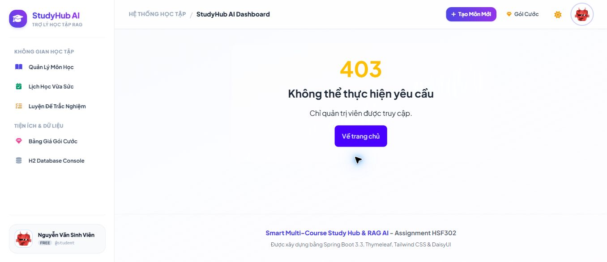
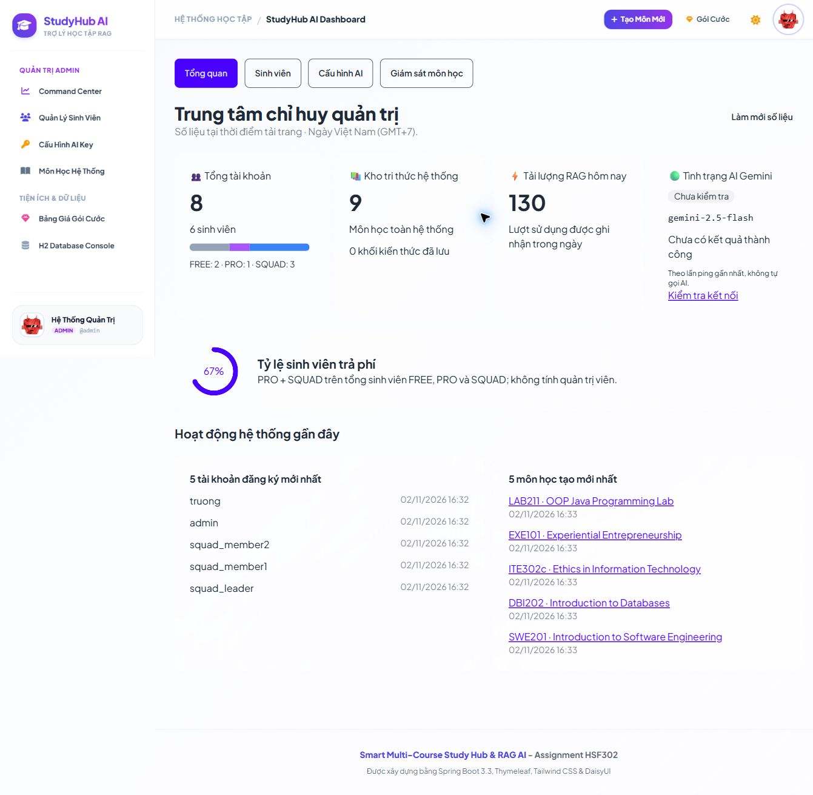
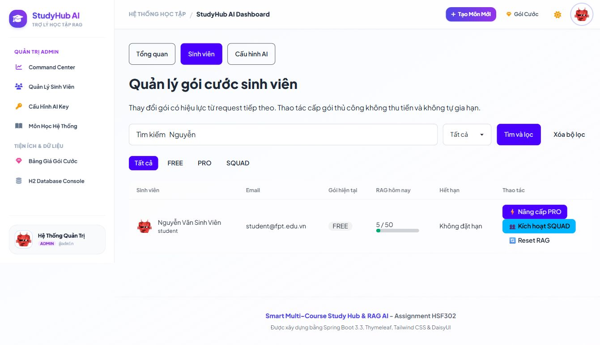
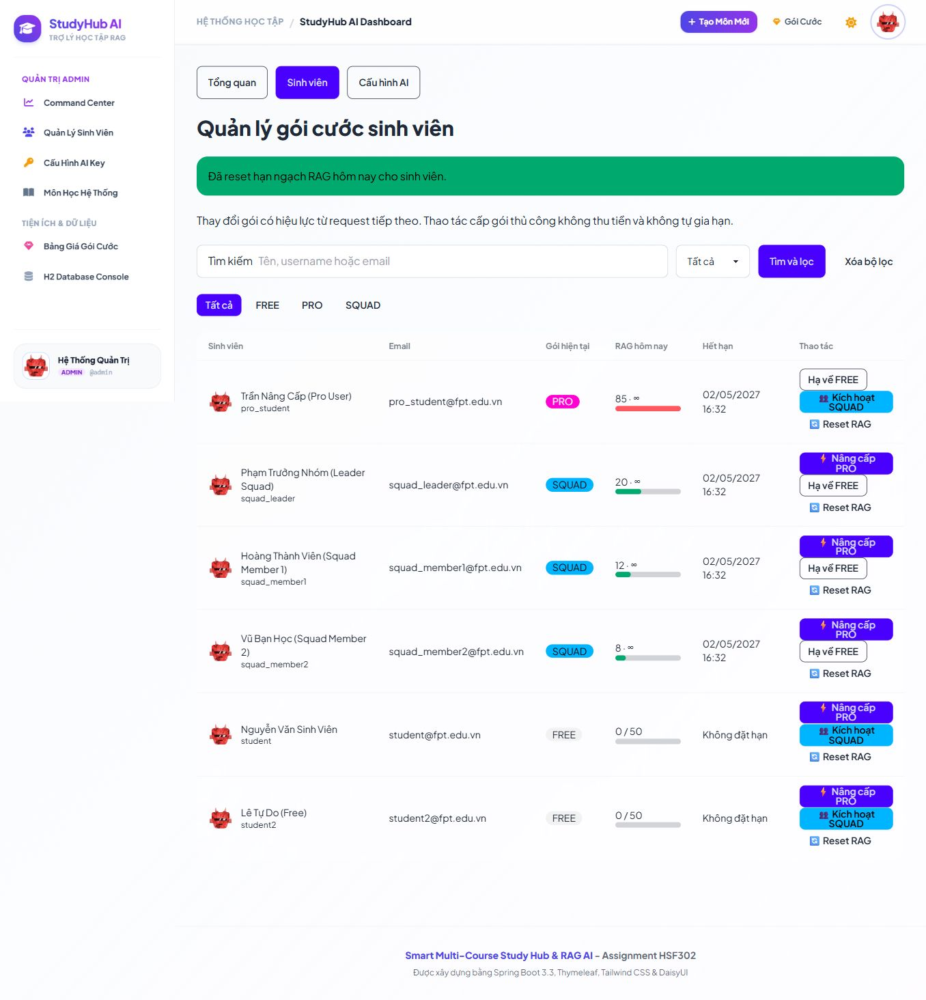
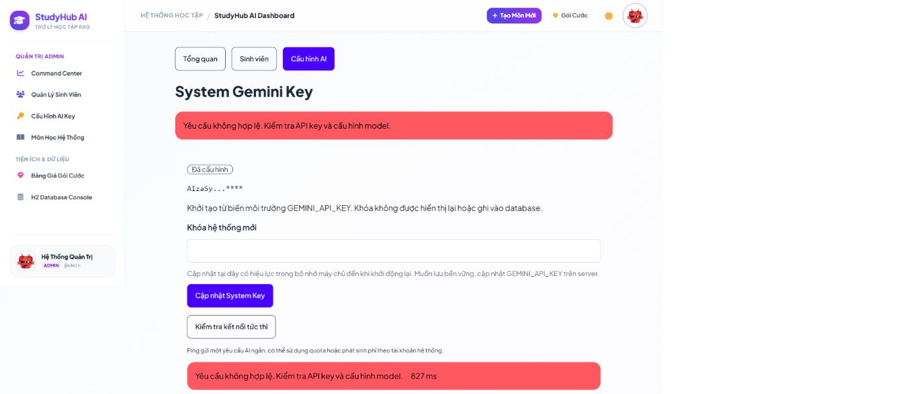

# Báo cáo kiểm thử Admin E2E — Ân — 02/11/2026

**Kết quả: 5 PASS, 1 BLOCKED. Không xác nhận 6/6 PASS.**

## Môi trường và phạm vi

- Bản kiểm thử: `main`, commit `e4a979017e17b87b4cfeb77c05dd00f44b1655f3`.
- Thực hiện ngày 02/11/2026, khoảng 16:32–16:40, giờ Việt Nam (GMT+7).
- Trình duyệt Brave; thao tác thực tế trên giao diện với tài khoản `student` và `admin`.
- URL QA: `http://localhost:8081`. Cổng 8080 đang được ứng dụng khác dùng; không dừng ứng dụng đó.
- Database riêng: `target/admin-e2e-20261102.mv.db`, tạo từ demo seeder của ứng dụng; không dùng hoặc chỉnh database `data/` hiện có.
- JDK 25.0.4, Spring Boot 3.3.4. Không sửa mã nguồn chức năng hay cấu hình được quản lý bởi Git.
- Ảnh chụp trực tiếp từ trình duyệt; chuyển định dạng JPEG sang PNG, không sửa nội dung ảnh. Ảnh dài chụp toàn trang; ADM-06 chụp viewport.

## Kết quả từng test case

### E2E-ADM-01 — PASS — Bảo vệ route quản trị

Đăng nhập `student`, truy cập `/admin/dashboard`. Giao diện hiển thị **403**, thông báo “Chỉ quản trị viên được truy cập.” và không hiển thị dashboard. Bộ AdminHubTest bổ sung xác nhận HTTP 403 và view `admin/error` cho tài khoản sinh viên.

### E2E-ADM-02 — PASS — Dashboard và thống kê

Đăng nhập `admin` bằng form, tự động vào `/admin/dashboard`. Dashboard hiển thị 8 tài khoản, 6 sinh viên; FREE 2, PRO 1, SQUAD 3; 9 môn học, 0 chunks, 130 lượt RAG hôm nay; tỷ lệ trả phí 67%; model `gemini-2.5-flash`. Các số tổng tài khoản, phân bố gói, môn học, chunks và RAG khớp truy vấn trực tiếp database QA. Trạng thái AI ban đầu “Chưa kiểm tra”, không tuyên bố online khi chưa ping thành công.

### E2E-ADM-03 — PASS — Danh sách, lọc gói và tìm theo tên

`/admin/users` hiển thị 6 sinh viên, không lẫn hai quản trị viên. Thao tác dropdown và nút “Tìm và lọc”: FREE trả `student`, `student2`; PRO trả `pro_student`; SQUAD trả `squad_leader`, `squad_member1`, `squad_member2`. Tìm tên `Nguyễn` với tất cả gói trả đúng một sinh viên `Nguyễn Văn Sinh Viên` (`student`).

Ảnh bổ sung: [FREE](E2E-ADM-03_free_an.png), [PRO](E2E-ADM-03_pro_an.png), [SQUAD](E2E-ADM-03_squad_an.png).

### E2E-ADM-04 — PASS — Đổi gói

Trên hàng của `student`, lần lượt bấm “Nâng cấp PRO”, “Kích hoạt SQUAD”, “Hạ về FREE”. Mỗi thao tác có thông báo thành công, badge tương ứng PRO → SQUAD → FREE; quota chuyển từ `5 / 50` sang `5 · ∞` khi nâng gói và trở về `5 / 50` khi hạ gói. Database kiểm tra cuối cùng xác nhận FREE, không có squad leader hay hạn gói phát sinh.

Ảnh bổ sung: [PRO](E2E-ADM-04_pro_an.png), [SQUAD](E2E-ADM-04_squad_an.png).

### E2E-ADM-05 — PASS — Reset RAG

Chuẩn bị **chỉ trong database QA** bằng SQL: đặt `student.daily_rag_count = 50`, `last_rag_reset_date = DATE '2026-11-02'`. Reload danh sách xác nhận `50 / 50`, bấm “Reset RAG cho student”; giao diện hiện thông báo thành công và `0 / 50`. Truy vấn database sau thao tác xác nhận bộ đếm là 0, ngày reset 02/11/2026, gói vẫn FREE. Đây là test reset; không gửi 50 câu hỏi AI thật.

Ảnh trước thao tác: [50/50](E2E-ADM-05_before_an.png).

### E2E-ADM-06 — BLOCKED — Masking và Test Ping

- Môi trường không cấu hình `GEMINI_API_KEY`; màn hình hiển thị “Chưa cấu hình”. Bấm Test Ping trả lỗi kiểm tra đầu vào, không báo thành công giả.
- Để kiểm tra masking, nhập **khóa giả QA không phải credential thật**. Sau lưu, trang hiển thị `AIzaSy...****`, trường nhập rỗng, không hiển thị lại toàn bộ khóa.
- Bấm Test Ping với khóa giả: phản hồi đỏ “Yêu cầu không hợp lệ. Kiểm tra API key và cấu hình model.”, **827 ms**. Đây là kết quả thất bại mong đợi với khóa giả, không phải lỗi kết nối của một khóa hợp lệ.
- **Chưa kiểm tra được yêu cầu thành công:** ping Google Gemini bằng key hợp lệ, thông báo xanh và latency. Chủ tài khoản đã chọn “Ghi nhận BLOCKED và bàn giao kết quả hiện có”.
- Không coi việc chưa cung cấp API key là lỗi chức năng. Cần cấu hình key hợp lệ và chạy lại luồng thành công để đóng case này.

Ảnh masking: [Khóa đã được che](E2E-ADM-06_masked_an.png).

## Kiểm thử tự động bổ sung

- Lệnh mặc định `mvn -B -Dtest=AdminHubTest test` lỗi khởi tạo Mockito trên JDK 25: Byte Buddy hiện hỗ trợ tới Java 23. 29 test bị lỗi môi trường, chưa chạy được assertion; không diễn giải là 29 lỗi nghiệp vụ.
- Chạy lại không sửa code: `mvn -B -Dtest=AdminHubTest -Dnet.bytebuddy.experimental=true test`.
- **29 test, 0 failures, 0 errors, 0 skipped — BUILD SUCCESS.** Đây là kiểm thử MockMvc/service; không thay thế luồng Gemini thật bị BLOCKED.
- [Bản tóm tắt Surefire](AdminHubTest-summary.txt).
- Log đầy đủ local: `target/admin-e2e-regression.log`, `target/admin-e2e-regression-compatible.log`; log app `target/admin-e2e-run-8081.log`.

## Lỗi và giới hạn

Không phát hiện lỗi chức năng Admin mới trong năm case đã PASS và các nhánh thiếu/sai key đã thử. Các trở ngại QA được ghi riêng trong [sổ theo dõi](../../issues/ISSUES-TRACKING.md): thiếu Gemini key hợp lệ và test runner mặc định chưa tương thích JDK 25.

Nút điền nhanh demo không hoạt động, tái hiện khi đăng nhập `student`; đây là lỗi Auth **ISSUE-02 đã được ghi nhận**, không tạo issue trùng. Đã nhập form thủ công để tiếp tục kiểm thử Admin.

## Khôi phục và bàn giao

- `student` trong database QA được khôi phục FREE, `daily_rag_count = 5` như trước test; `squad_leader_username = null`, `tier_expires_at = null`.
- Database đang dùng riêng cho QA; không thay đổi dữ liệu demo làm việc hiện có.
- Khóa giả chỉ được lưu trong bộ nhớ tiến trình QA; tiến trình QA được dừng khi bàn giao để xóa cấu hình tạm này.
- Bộ bằng chứng có 6 ảnh chính đúng mã ADM-01 đến ADM-06 và 7 ảnh phụ.
- Chưa kiểm thử mobile, toàn bộ phân hệ khác hoặc Gemini với key hợp lệ. Chưa xác nhận 100% hoàn thành yêu cầu ngày 02/11 do ADM-06 còn BLOCKED.
