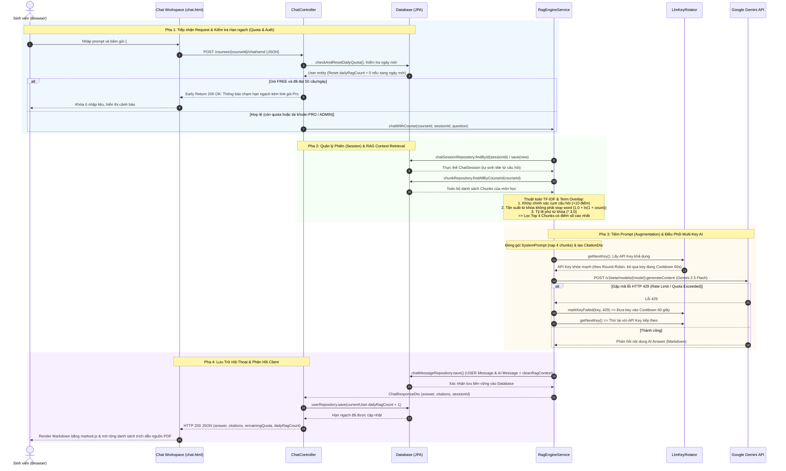

# Thiết Kế Kiến Trúc & Sơ Đồ Luồng "Chat Với AI" (Smart StudyHub RAG)

Tài liệu này ghi lại chi tiết kiến trúc kỹ thuật và luồng xử lý thực tế của tính năng **"Chat với AI Giáo trình"** trong hệ thống Smart StudyHub.

---

## 1. Sơ Đồ Tuần Tự (Sequence Diagram) - Vòng Đời Yêu Cầu

Sơ đồ mô tả chi tiết chu trình sống của một request chat khi sinh viên gửi câu hỏi từ giao diện Web đến khi nhận được phản hồi Markdown kèm trích dẫn số trang PDF giáo trình.

---

## 2. Sơ Đồ Luồng Xử Lý Logic & Dự Phòng (Workflow Diagram)

Sơ đồ thể hiện luồng logic theo từng bước từ khi nhận prompt đến khi hoàn tất và tất cả các nhánh rẽ lỗi / fallback (hết hạn ngạch, không tìm thấy ngữ cảnh, lỗi API Key, timeout).

```mermaid
flowchart TD
    classDef startEnd fill:#3b82f6,stroke:#1d4ed8,color:#fff,stroke-width:2px;
    classDef process fill:#f8fafc,stroke:#475569,color:#0f172a,stroke-width:1.5px;
    classDef decision fill:#fef3c7,stroke:#d97706,color:#78350f,stroke-width:2px;
    classDef fallback fill:#fee2e2,stroke:#ef4444,color:#991b1b,stroke-width:1.5px;
    classDef success fill:#dcfce7,stroke:#16a34a,color:#14532d,stroke-width:2px;

    UserPrompt(["1. Sinh viên gửi Prompt tại #chatForm"]):::startEnd --> Validate["2. ChatController.sendChatMessageJson():<br/>Kiểm tra rỗng & phiên đăng nhập"]:::process

    Validate --> AuthCheck{"Người dùng hợp lệ?"}:::decision
    AuthCheck -- "Chưa đăng nhập / Rỗng" --> BadReq["Trả về lỗi 400 Bad Request / 401 Unauthorized"]:::fallback
    AuthCheck -- "Đã xác thực" --> CheckReset["3. checkAndResetDailyQuota():<br/>Reset về 0 nếu hôm nay > lastRagResetDate"]:::process

    CheckReset --> QuotaCheck{"Kiểm tra hạn ngạch<br/>(Subscription Tier)"}:::decision
    QuotaCheck -- "Gói FREE và dailyCount >= 50" --> EarlyReturnQuota["🛑 Early Return HTTP 200:<br/>Thông báo hết 50 câu RAG/ngày & gửi link nâng cấp Pro"]:::fallback
    EarlyReturnQuota --> ClientRender

    QuotaCheck -- "Còn hạn ngạch hoặc gói PRO / SQUAD / ADMIN" --> SessionInit["4. Quản lý ChatSession:<br/>- sessionId có sẵn: nạp session<br/>- sessionId null: tạo mới tự động sinh tiêu đề"]:::process

    SessionInit --> SearchRag["5. RAG Retrieval (RagEngineService):<br/>Truy vấn tất cả Chunks của môn học theo courseId"]:::process
    SearchRag --> ScoreChunks["Tính điểm độ liên quan (calculateRelevanceScore):<br/>Exact phrase (+10) + TF-IDF (1 + ln(count)) + Coverage (*3)"]:::process

    ScoreChunks --> MatchCheck{"Có đoạn Chunk nào<br/>có điểm score > 0?"}:::decision
    MatchCheck -- "Có" --> PickTop4["Lấy Top 4 Chunks có điểm số cao nhất"]:::process
    MatchCheck -- "Không có đoạn khớp" --> FallbackTop4["⚠️ Fallback:<br/>Lấy 4 Chunks đầu tiên của môn học làm ngữ cảnh"]:::fallback

    PickTop4 --> BuildPrompt["6. Đóng gói System Prompt & CitationDto:<br/>- Tiêm Chunks vào ngữ cảnh nội bộ<br/>- Sinh danh sách Citation (file, số trang, trích đoạn)"]:::process
    FallbackTop4 --> BuildPrompt

    BuildPrompt --> CheckKey{"Kiểm tra Centralized System Key<br/>trên máy chủ"}:::decision
    CheckKey -- "Chưa cấu hình API Key" --> FallbackNoKey["⚠️ Trả về cảnh báo chưa cấu hình System Key<br/>kèm gợi ý trích xuất các đoạn tìm được"]:::fallback
    FallbackNoKey --> SaveMessages

    CheckKey -- "Đã cấu hình" --> KeyRotator["7. LlmKeyRotator.getNextKey():<br/>Lấy Key khỏe mạnh theo Round-Robin (bỏ qua key Cooldown)"]:::process
    KeyRotator --> CallGemini["8. Gọi REST API Google Gemini:<br/>Cascade qua danh sách mô hình (gemini-2.5-flash -> 2.0-flash...)"]:::process

    CallGemini --> CallApiResult{"Kết quả gọi API"}:::decision
    CallApiResult -- "Lỗi HTTP 429 Rate Limit" --> Handle429["Đưa Key vào Cooldown 60s (markKeyFailed)<br/>và xoay vòng sang Key kế tiếp"]:::fallback
    Handle429 --> KeyRotator

    CallApiResult -- "Tất cả Keys/Models đều thất bại" --> HandleAllFail["❌ Bắt lỗi: Tạo thông báo AI đang điều phối cụm Key,<br/>vui lòng thử lại sau giây lát"]:::fallback
    HandleAllFail --> SaveMessages

    CallApiResult -- "Thành công" --> AiResponseOk["Nhận chuỗi phản hồi AI Markdown"]:::process
    AiResponseOk --> SaveMessages

    SaveMessages["9. Lưu lịch sử (saveMessages):<br/>- ChatMessage USER (câu hỏi, tokenCount)<br/>- ChatMessage AI (câu trả lời, cleanRagContext, tokenCount)"]:::process

    SaveMessages --> AutoTitle["10. Tự động cập nhật tiêu đề Session<br/>(nếu đang là 'Cuộc trò chuyện mới' thì lấy 40 ký tự đầu của prompt)"]:::process

    AutoTitle --> IncQuota["11. Tăng biến đếm hạn ngạch:<br/>currentUser.dailyRagCount += 1 & lưu UserRepository"]:::process

    IncQuota --> BuildResponseDto["12. Đóng gói ChatResponseDto:<br/>answer, citations, sessionId, remainingQuota, dailyRagCount"]:::process

    BuildResponseDto --> ClientRender(["13. Client (chat.html):<br/>- marked.js render câu trả lời Markdown<br/>- Tạo toggle danh sách nguồn trích dẫn PDF<br/>- Cập nhật thanh tiến trình Quota Bar thời gian thực"]):::success
```

---

## 3. Bảng Tra Cứu Mã Nguồn Thực Tế (Source Evidence Matrix)

| Thành phần | Class / File | Hàm / Phương thức chính | Vai trò trong hệ thống |
| :--- | :--- | :--- | :--- |
| **Giao diện Chat** | `templates/rag/chat.html` | Event listener `#chatForm` submit (dòng 486-556) | Bắt sự kiện submit qua Fetch API, hiển thị indicator, render Markdown và toggle citation |
| **Điều phối REST** | `ChatController.java` | `sendChatMessageJson()` (dòng 106-182) | Validate đầu vào, chặn hạn ngạch gói Free, gọi RAG engine và cập nhật số câu hỏi trong ngày |
| **Kiểm soát Hạn ngạch** | `ChatController.java` | `checkAndResetDailyQuota()` (dòng 322-336) | Tự động reset `dailyRagCount = 0` khi người dùng gửi câu hỏi ở ngày mới |
| **RAG Orchestrator** | `RagEngineService.java` | `chatWithCourse()` (dòng 220-300) | Điều phối toàn bộ luồng RAG: quản lý session, tìm chunks, nạp key và gọi LLM |
| **Tìm kiếm Ngữ cảnh** | `RagEngineService.java` | `findRelevantChunks()` (dòng 55-89) | Thuật toán TF-IDF / Term Overlap chấm điểm và chọn ra Top 4 Chunks liên quan |
| **Tiêm System Prompt** | `RagEngineService.java` | `buildSystemPrompt()` (dòng 161-184) | Đóng gói Prompt chứa ngữ cảnh giáo trình, câu hỏi và quy tắc trích dẫn nguồn |
| **Đóng gói Trích dẫn** | `RagEngineService.java` | `buildCitations()` (dòng 189-203) | Tạo `CitationDto` chứa số trang PDF và tên file giáo trình |
| **Xoay vòng Multi-Key** | `LlmKeyRotator.java` | `getNextKey()` & `markKeyFailed()` (dòng 45-90) | Lấy Key khả dụng qua Round-Robin và đưa Key bị 429 vào Cooldown 60s |
| **Gọi API LLM** | `RagEngineService.java` | `callGeminiApi()` (dòng 373-412) | Gọi Google Gemini REST API qua cơ chế cascade 6 models |
| **Lưu lịch sử hội thoại**| `RagEngineService.java` | `saveMessages()` (dòng 414-448) | Lưu đồng thời tin nhắn User và AI (kèm `cleanRagContext`) vào Database |
| **Cơ sở dữ liệu** | `ChatMessageRepository`, `ChatSessionRepository` | JPA CRUD methods | Lưu trữ phiên và tin nhắn trên H2 Database / MySQL |
